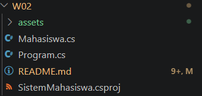
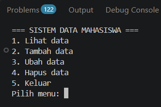
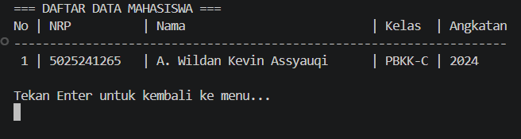
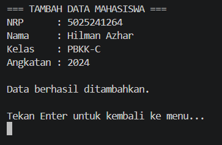
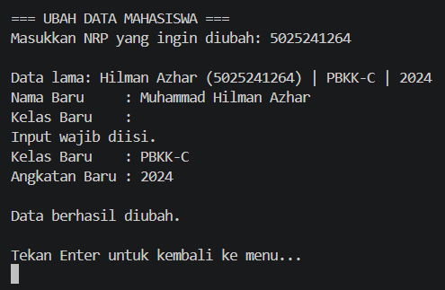
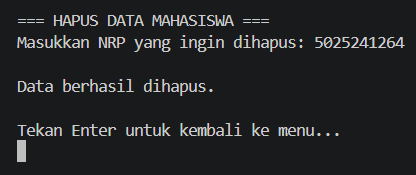

# Tugas 2 - Pemrograman Berbasis Kerangka Kerja C

## Deskripsi
Assalamualaikum Warahmatullahi Wabarakatuh, 

Pada kuliah pertemuan kedua dalam kelas Pemrograman Berbasis Kerangka Kerja kelas C,
Saya mempelajari dasar-dasar pengembangan aplikasi menggunakan `.NET` dan bahasa `C#`. Materi diawali dengan pengenalan arsitektur .NET (CLR, FCL), instalasi .NET SDK, pembuatan program sederhana "Hello World", kemudian dilanjutkan dengan pembuatan aplikasi konsol sederhana untuk mengelola data mahasiswa melalui operasi CRUD (*Create, Read, Update, Delete*) menggunakan bahasa C#.

Untuk materi dan modul kuliah dapat diakses melalui link [berikut](http://fajarbaskoro.blogspot.com/2021/03/net-framework.html).

---

## Langkah Implementasi

### 1. Verifikasi Instalasi .NET SDK & Hello World
Langkah awal adalah memastikan .NET SDK telah terpasang pada komputer dan dapat dijalankan melalui terminal / command prompt:
```powershell
dotnet --version
```
Untuk menguji program pertama "Hello World":
```csharp
Console.WriteLine("Hello, World!");
```

- **Screenshot Verifikasi .NET & Hello World**
  
  

---

### 2. Struktur Proyek Aplikasi Data Mahasiswa
Program yang dibuat adalah aplikasi **Sistem Data Mahasiswa** berbasis console menggunakan C# dan .NET. Aplikasi ini menyediakan menu interaktif dengan fitur:
- Menampilkan data mahasiswa (*Read*)
- Menambahkan data mahasiswa baru (*Create*)
- Mengubah data mahasiswa (*Update*)
- Menghapus data mahasiswa (*Delete*)
- Keluar dari aplikasi

Struktur file pada folder `W02`:
```text
W02/
├── assets/
│   └── (tangkapan layar hasil program)
├── Mahasiswa.cs
├── Program.cs
├── SistemMahasiswa.csproj
└── README.md
```

- **Screenshot Struktur Proyek di Code Editor**
  
  

---

### 3. File Konfigurasi Proyek (`SistemMahasiswa.csproj`)
File ini mendefinisikan target framework yang digunakan (.NET 8.0):
```xml
<Project Sdk="Microsoft.NET.Sdk">

  <PropertyGroup>
    <OutputType>Exe</OutputType>
    <TargetFramework>net8.0</TargetFramework>
    <ImplicitUsings>enable</ImplicitUsings>
    <Nullable>enable</Nullable>
  </PropertyGroup>

</Project>
```

---

### 4. Model Data Mahasiswa (`Mahasiswa.cs`)
Class `Mahasiswa` digunakan sebagai model data untuk merepresentasikan entitas mahasiswa:
```csharp
namespace SistemMahasiswa;

public class Mahasiswa
{
    public string Nrp { get; set; } = "";
    public string Nama { get; set; } = "";
    public string Kelas { get; set; } = "";
    public string Tahun { get; set; } = "";
}
```
Class ini memiliki 4 properti:
- `Nrp` : Menyimpan nomor registrasi pokok mahasiswa.
- `Nama` : Menyimpan nama lengkap mahasiswa.
- `Kelas` : Menyimpan kelas mahasiswa (misal: `PBKK-C`).
- `Tahun` : Menyimpan tahun angkatan masuk mahasiswa.

---

### 5. Kode Program Utama (`Program.cs`)
File utama yang mengatur alur logika aplikasi, penyimpanan data sementara di memori dengan `List<Mahasiswa>`, serta navigasi menu:

```csharp
using System;
using System.Collections.Generic;
using System.Linq;

namespace SistemMahasiswa;

internal class Program
{
    private static readonly List<Mahasiswa> daftarMahasiswa = new()
    {
        new Mahasiswa { Nrp = "5025241265", Nama = "A. Wildan Kevin Assyauqi", Kelas = "PBKK-C", Tahun = "2024" }
    };

    public static void Main(string[] args)
    {
        while (true)
        {
            ClearScreen();
            Console.WriteLine("=== SISTEM DATA MAHASISWA ===");
            Console.WriteLine("1. Lihat data");
            Console.WriteLine("2. Tambah data");
            Console.WriteLine("3. Ubah data");
            Console.WriteLine("4. Hapus data");
            Console.WriteLine("5. Keluar");
            Console.Write("Pilih menu: ");

            var line = Console.ReadLine();
            if (line == null) break;
            var pilihan = line.Trim('\uFEFF', ' ', '\r', '\n', '\t');
            if (string.IsNullOrEmpty(pilihan)) continue;

            switch (pilihan)
            {
                case "1": LihatData(); break;
                case "2": TambahData(); break;
                case "3": UbahData(); break;
                case "4": HapusData(); break;
                case "5": return;
                default: Pesan("Pilihan tidak tersedia."); break;
            }
        }
    }

    private static void LihatData()
    {
        ClearScreen();
        Console.WriteLine("=== DAFTAR DATA MAHASISWA ===");
        if (daftarMahasiswa.Count == 0)
        {
            Console.WriteLine("Belum ada data mahasiswa.");
        }
        else
        {
            Console.WriteLine("No | NRP          | Nama                          | Kelas  | Angkatan");
            Console.WriteLine("---------------------------------------------------------------------");
            for (var i = 0; i < daftarMahasiswa.Count; i++)
            {
                var m = daftarMahasiswa[i];
                Console.WriteLine($"{i + 1,2} | {m.Nrp,-12} | {m.Nama,-29} | {m.Kelas,-6} | {m.Tahun,-8}");
            }
        }
        Jeda();
    }

    private static void TambahData()
    {
        ClearScreen();
        Console.WriteLine("=== TAMBAH DATA MAHASISWA ===");
        var data = BacaData();

        if (daftarMahasiswa.Any(m => m.Nrp.Equals(data.Nrp, StringComparison.OrdinalIgnoreCase)))
        {
            Pesan("Gagal: Mahasiswa dengan NRP tersebut sudah terdaftar!");
            return;
        }

        daftarMahasiswa.Add(data);
        Pesan("Data berhasil ditambahkan.");
    }

    private static void UbahData()
    {
        ClearScreen();
        Console.WriteLine("=== UBAH DATA MAHASISWA ===");
        var nrp = BacaWajib("Masukkan NRP yang ingin diubah: ");
        var data = daftarMahasiswa.FirstOrDefault(m => m.Nrp.Equals(nrp, StringComparison.OrdinalIgnoreCase));

        if (data == null)
        {
            Pesan("Data mahasiswa tidak ditemukan.");
            return;
        }

        Console.WriteLine($"\nData lama: {data.Nama} ({data.Nrp}) | {data.Kelas} | {data.Tahun}");
        data.Nama = BacaWajib("Nama Baru     : ");
        data.Kelas = BacaWajib("Kelas Baru    : ");
        data.Tahun = BacaWajib("Angkatan Baru : ");

        Pesan("Data berhasil diubah.");
    }

    private static void HapusData()
    {
        ClearScreen();
        Console.WriteLine("=== HAPUS DATA MAHASISWA ===");
        var nrp = BacaWajib("Masukkan NRP yang ingin dihapus: ");
        var data = daftarMahasiswa.FirstOrDefault(m => m.Nrp.Equals(nrp, StringComparison.OrdinalIgnoreCase));

        if (data == null)
        {
            Pesan("Data mahasiswa tidak ditemukan.");
            return;
        }

        daftarMahasiswa.Remove(data);
        Pesan("Data berhasil dihapus.");
    }

    private static Mahasiswa BacaData() => new()
    {
        Nrp = BacaWajib("NRP      : "),
        Nama = BacaWajib("Nama     : "),
        Kelas = BacaWajib("Kelas    : "),
        Tahun = BacaWajib("Angkatan : ")
    };

    private static string BacaWajib(string label)
    {
        while (true)
        {
            Console.Write(label);
            var line = Console.ReadLine();
            var input = line?.Trim('\uFEFF', ' ', '\r', '\n', '\t') ?? "";
            if (!string.IsNullOrWhiteSpace(input)) return input;
            Console.WriteLine("Input wajib diisi.");
        }
    }

    private static void Pesan(string pesan)
    {
        Console.WriteLine($"\n{pesan}");
        Jeda();
    }

    private static void Jeda()
    {
        if (Console.IsInputRedirected) return;
        Console.WriteLine("\nTekan Enter untuk kembali ke menu...");
        Console.ReadLine();
    }

    private static void ClearScreen()
    {
        if (!Console.IsOutputRedirected) Console.Clear();
    }
}
```

---

## Preview dan Hasil Eksekusi

Berikut adalah tangkapan layar hasil eksekusi program:

### 1. Tampilan Menu Utama
Menampilkan menu navigasi aplikasi Sistem Data Mahasiswa saat pertama kali dijalankan.



### 2. Tampilan Lihat Data Mahasiswa
Menampilkan daftar seluruh data mahasiswa yang tersimpan di dalam `List<Mahasiswa>`.



### 3. Tampilan Tambah Data Mahasiswa
Proses penambahan mahasiswa baru dengan validasi agar NRP tidak boleh duplikat dan input tidak boleh kosong.



### 4. Tampilan Ubah Data Mahasiswa
Proses memperbarui data nama, kelas, atau angkatan berdasarkan NRP mahasiswa.



### 5. Tampilan Hapus Data Mahasiswa
Proses menghapus data mahasiswa dari sistem berdasarkan NRP.



Terimakasih.

---

## Identitas
- **Nama**   : A. Wildan Kevin Assyauqi  
- **NRP**    : 5025241265  
- **Kelas**  : Pemrograman Berbasis Kerangka Kerja - C
