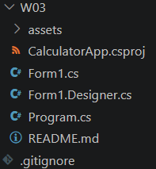
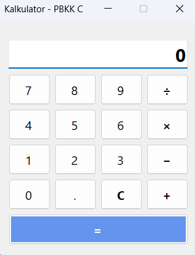
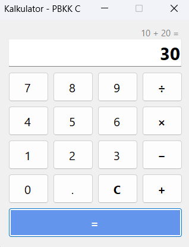
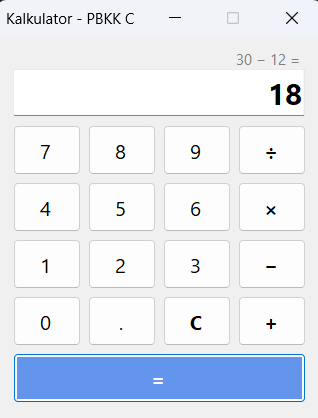
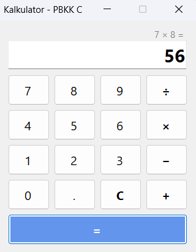
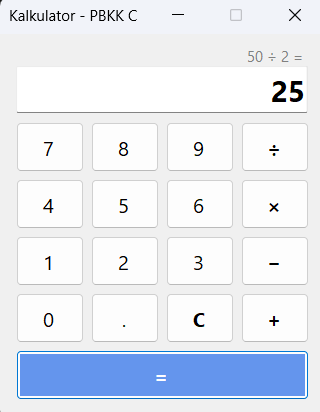

# Tugas 3 - Pemrograman Berbasis Kerangka Kerja C

## Deskripsi
Assalamualaikum Warahmatullahi Wabarakatuh, 

Pada kuliah pertemuan ketiga dalam kelas Pemrograman Berbasis Kerangka Kerja kelas C,
Saya mempelajari pengembangan aplikasi desktop berbasis GUI (*Graphical User Interface*) menggunakan teknologi **Windows Forms App (.NET)** dan bahasa **C#**. Pada pertemuan ini, mahasiswa ditugaskan untuk mengimplementasikan aplikasi **Kalkulator Desktop Sederhana** yang mampu menangani input angka, operasi aritmatika dasar (penjumlahan, pengurangan, perkalian, pembagian), titik desimal, serta penanganan kesalahan (*error handling*) seperti pembagian dengan angka nol.

Untuk materi kuliah dapat diakses melalui link [berikut](http://fajarbaskoro.blogspot.com/2021/03/pbkk-3-membuat-aplikasi-dengan-net.html).

---

## Langkah Implementasi

### 1. Inisialisasi Proyek Windows Forms
Proyek dibuat menggunakan template `winforms` pada .NET CLI melalui terminal:
```powershell
dotnet new winforms -n CalculatorApp
```

Struktur file pada folder `W03`:
```text
W03/
├── assets/
│   └── (tangkapan layar hasil program)
├── CalculatorApp.csproj
├── Program.cs
├── Form1.cs
├── Form1.Designer.cs
└── README.md
```

- **Screenshot Struktur Proyek di Code Editor**
  
  

---

### 2. Konfigurasi Proyek (`CalculatorApp.csproj`)
File project menggunakan SDK `Microsoft.NET.Sdk` dengan target Windows Desktop (.NET 8.0-windows) dan mengaktifkan fitur `UseWindowsForms`:
```xml
<Project Sdk="Microsoft.NET.Sdk">

  <PropertyGroup>
    <OutputType>WinExe</OutputType>
    <TargetFramework>net8.0-windows</TargetFramework>
    <Nullable>enable</Nullable>
    <UseWindowsForms>true</UseWindowsForms>
    <ImplicitUsings>enable</ImplicitUsings>
    <RootNamespace>CalculatorApp</RootNamespace>
  </PropertyGroup>

</Project>
```

---

### 3. Desain Tampilan Form (`Form1.Designer.cs`)
Komponen visual disusun dengan tata letak grid 4 kolom yang ergonomis:
- **`lblHistory`** : Label kecil di atas layar untuk menampilkan histori operasi (misal: `10 +`).
- **`txtDisplay`** : Kotak teks tampilan angka dengan properti `ReadOnly = true`, `TextAlign = Right`, dan font tebal berukuran 18pt.
- **Tombol Angka (0-9)** : Disusun secara intuitif menyerupai kalkulator fisik.
- **Tombol Operator (+, −, ×, ÷)** : Dihubungkan ke handler event operator.
- **Tombol Titik Desimal (.) & Clear (C)** : Untuk input desimal dan me-reset nilai kalkulator.
- **Tombol Sama Dengan (=)** : Diberi warna pembeda dan membentang selebar baris bawah.

---

### 4. Logika Perhitungan & Event Handler (`Form1.cs`)
File ini menangani seluruh proses interaksi dan logika komputasi kalkulator:

```csharp
using System;
using System.Globalization;
using System.Windows.Forms;

namespace CalculatorApp;

public partial class Form1 : Form
{
    private double firstNumber = 0;
    private double secondNumber = 0;
    private double result = 0;
    private string operation = "";
    private bool startNewNumber = false;

    public Form1()
    {
        InitializeComponent();
    }

    private void NumberButton_Click(object? sender, EventArgs e)
    {
        if (sender is not Button button) return;

        if (txtDisplay.Text == "0" || startNewNumber)
        {
            txtDisplay.Text = button.Text;
            startNewNumber = false;
        }
        else
        {
            txtDisplay.Text += button.Text;
        }
    }

    private void OperatorButton_Click(object? sender, EventArgs e)
    {
        if (sender is not Button button) return;

        if (string.IsNullOrEmpty(txtDisplay.Text))
        {
            if (!string.IsNullOrEmpty(operation))
            {
                operation = button.Text;
                lblHistory.Text = $"{firstNumber} {operation}";
            }
            return;
        }

        if (!double.TryParse(txtDisplay.Text, NumberStyles.Float, CultureInfo.InvariantCulture, out double value))
            return;

        firstNumber = value;
        operation = button.Text;
        lblHistory.Text = $"{firstNumber} {operation}";
        startNewNumber = false;

        txtDisplay.Clear();
    }

    private void btnEquals_Click(object? sender, EventArgs e)
    {
        if (string.IsNullOrEmpty(operation)) return;

        try
        {
            if (!double.TryParse(txtDisplay.Text, NumberStyles.Float, CultureInfo.InvariantCulture, out secondNumber))
            {
                throw new FormatException("Masukkan angka kedua terlebih dahulu.");
            }

            switch (operation)
            {
                case "+":
                    result = firstNumber + secondNumber;
                    break;
                case "−":
                    result = firstNumber - secondNumber;
                    break;
                case "×":
                    result = firstNumber * secondNumber;
                    break;
                case "÷":
                    if (secondNumber == 0)
                    {
                        throw new DivideByZeroException("Tidak bisa membagi dengan angka nol.");
                    }
                    result = firstNumber / secondNumber;
                    break;
            }

            lblHistory.Text = $"{firstNumber} {operation} {secondNumber} =";
            txtDisplay.Text = result.ToString(CultureInfo.InvariantCulture);
            operation = "";
            startNewNumber = true;
        }
        catch (DivideByZeroException ex)
        {
            MessageBox.Show(ex.Message, "Peringatan", MessageBoxButtons.OK, MessageBoxIcon.Warning);
            ResetCalculator();
        }
        catch (Exception ex)
        {
            MessageBox.Show(ex.Message, "Error", MessageBoxButtons.OK, MessageBoxIcon.Error);
        }
    }

    private void btnClear_Click(object? sender, EventArgs e)
    {
        ResetCalculator();
    }

    private void btnDecimal_Click(object? sender, EventArgs e)
    {
        if (string.IsNullOrEmpty(txtDisplay.Text) || startNewNumber)
        {
            txtDisplay.Text = "0.";
            startNewNumber = false;
        }
        else if (!txtDisplay.Text.Contains('.'))
        {
            txtDisplay.Text += ".";
        }
    }

    private void ResetCalculator()
    {
        firstNumber = 0;
        secondNumber = 0;
        result = 0;
        operation = "";
        startNewNumber = false;
        lblHistory.Text = "";
        txtDisplay.Text = "0";
    }
}
```

Poin-poin penting dalam implementasi:
1. **`CultureInfo.InvariantCulture`**: Memastikan parsing angka desimal menggunakan titik (`.`) tetap berjalan konsisten di semua konfigurasi regional Windows pengguna.
2. **`startNewNumber`**: Menandai apakah angka berikutnya akan mereset tampilan display setelah pengguna menekan tombol sama dengan (`=`).
3. **Penanganan Pembagian dengan Nol**: Divalidasi secara eksplisit dengan melempar `DivideByZeroException` dan menampilkan `MessageBox` peringatan agar program tidak *crash*.

---

## Preview dan Hasil Eksekusi

Berikut adalah tangkapan layar hasil pengujian aplikasi kalkulator:

### 1. Tampilan Awal Kalkulator
Kondisi awal form saat aplikasi pertama kali dijalankan (display bernilai `0`).



### 2. Operasi Penjumlahan (+)
Pengujian perhitungan penjumlahan: `10 + 20 = 30`.



### 3. Operasi Pengurangan (−)
Pengujian perhitungan pengurangan: `30 − 12 = 18`.



### 4. Operasi Perkalian (×)
Pengujian perhitungan perkalian: `7 × 8 = 56`.



### 5. Operasi Pembagian (÷) dan Validasi Bagi Nol
Pengujian pembagian normal (`50 ÷ 2 = 25`) serta penanganan dialog peringatan ketika membagi angka dengan `0`.



Terimakasih.

---

## Identitas
- **Nama**   : A. Wildan Kevin Assyauqi  
- **NRP**    : 5025241265  
- **Kelas**  : Pemrograman Berbasis Kerangka Kerja - C
