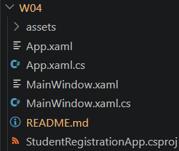
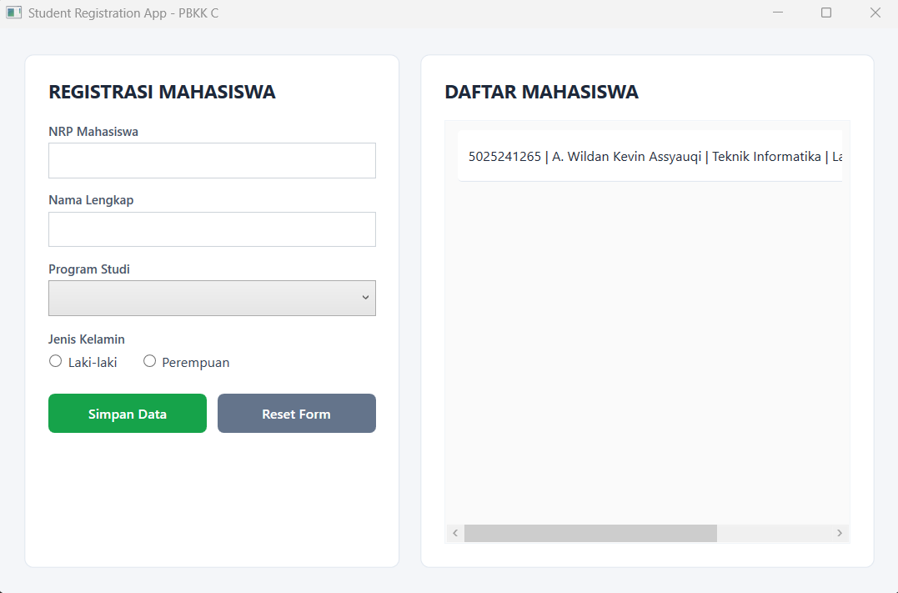
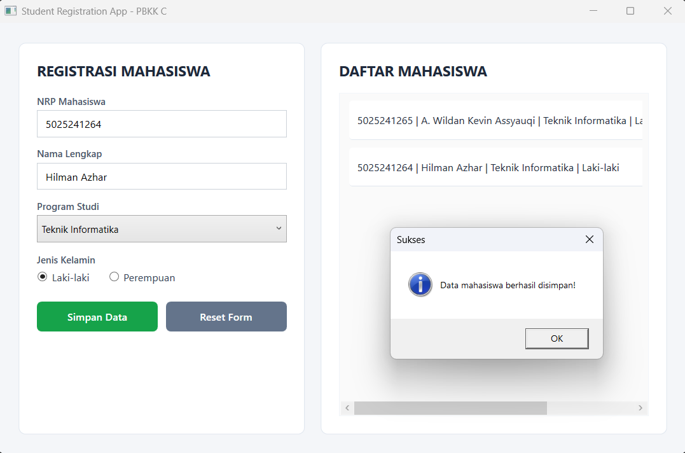
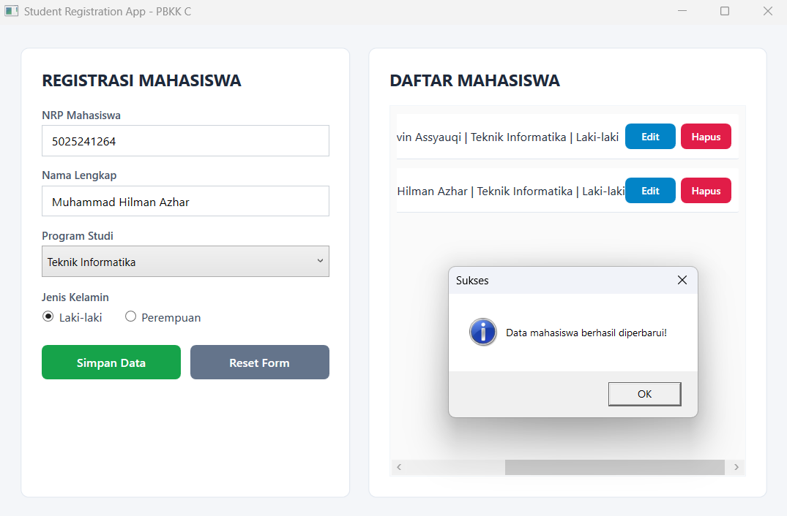
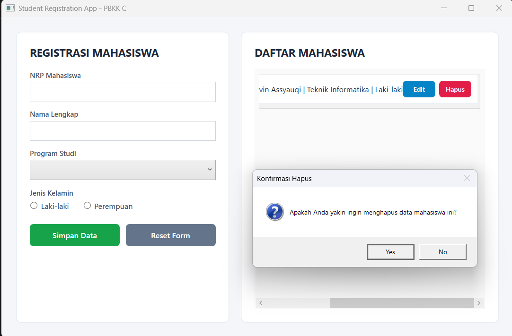
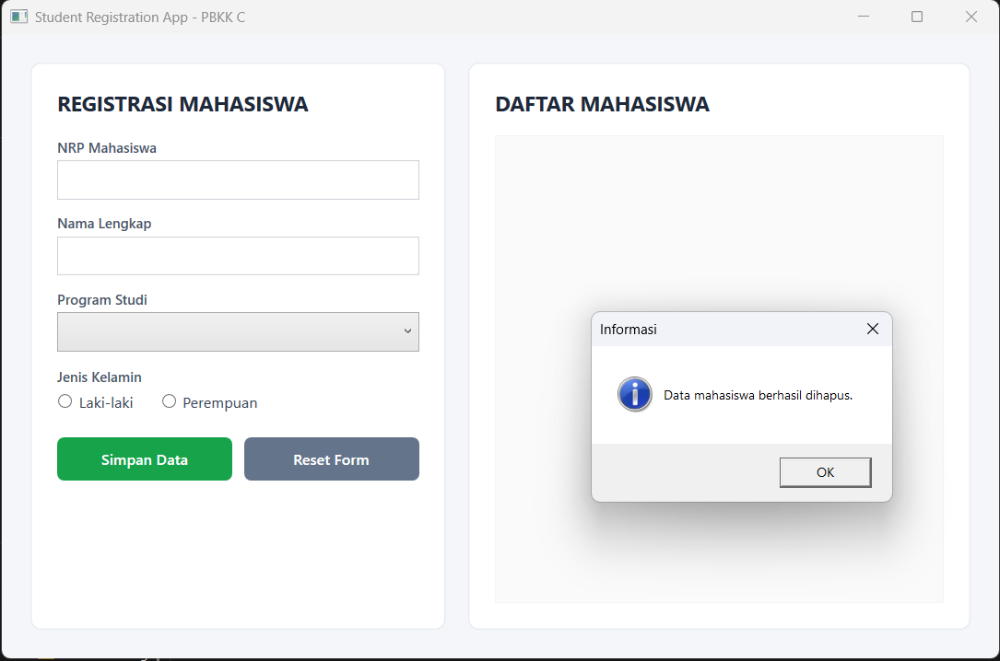

# Tugas 4 - Pemrograman Berbasis Kerangka Kerja C

## Deskripsi
Assalamualaikum Warahmatullahi Wabarakatuh, 

Pada kuliah pertemuan keempat dalam kelas Pemrograman Berbasis Kerangka Kerja kelas C,
Saya mempelajari pengembangan antarmuka grafis desktop modern menggunakan **Windows Presentation Foundation (WPF)** dengan bahasa pemrograman **C#** dan bahasa markup **XAML** di atas platform .NET. Pada pertemuan ini, mahasiswa ditugaskan untuk mengimplementasikan aplikasi **Student Registration App** (Registrasi Mahasiswa) yang memiliki antarmuka interaktif dan fungsionalitas CRUD (*Create, Read, Update, Delete*) lengkap untuk mengelola data mahasiswa.

Untuk materi kuliah dapat diakses melalui link [berikut](http://fajarbaskoro.blogspot.com/2021/03/pbkk-windows-presentation-foundation.html) dan [latihan WPF](http://fajarbaskoro.blogspot.com/2022/02/pbkk-latihan-wpf.html).

---

## Langkah Implementasi

### 1. Inisialisasi Proyek WPF
Proyek dibuat menggunakan template `wpf` pada .NET CLI melalui terminal:
```powershell
dotnet new wpf -n StudentRegistrationApp
```

Struktur file pada folder `W04`:
```text
W04/
├── assets/
│   └── (tangkapan layar hasil program)
├── App.xaml
├── App.xaml.cs
├── MainWindow.xaml
├── MainWindow.xaml.cs
├── StudentRegistrationApp.csproj
└── README.md
```

- **Screenshot Struktur Proyek di Code Editor**
  
  

---

### 2. Konfigurasi Proyek (`StudentRegistrationApp.csproj`)
File project mendefinisikan target runtime Windows (.NET 8.0-windows) serta mengaktifkan modul WPF melalui properti `<UseWPF>true</UseWPF>`:
```xml
<Project Sdk="Microsoft.NET.Sdk">

  <PropertyGroup>
    <OutputType>WinExe</OutputType>
    <TargetFramework>net8.0-windows</TargetFramework>
    <Nullable>enable</Nullable>
    <ImplicitUsings>enable</ImplicitUsings>
    <UseWPF>true</UseWPF>
    <RootNamespace>StudentRegistrationApp</RootNamespace>
  </PropertyGroup>

</Project>
```

---

### 3. Desain Antarmuka Pengguna XAML (`MainWindow.xaml`)
Desain antarmuka dibagi menjadi 2 kolom utama menggunakan elemen layout `Grid`:
1. **Panel Formulir Registrasi (Kiri):**
   - **`txtNrp`**: `TextBox` untuk input Nomor Registrasi Pokok mahasiswa.
   - **`txtNama`**: `TextBox` untuk input nama lengkap mahasiswa.
   - **`cmbProdi`**: `ComboBox` pilihan Program Studi (Teknik Informatika, Sistem Informasi, Sains Data, Teknik Komputer, Rekayasa Perangkat Lunak).
   - **`rbLaki` & `rbPerempuan`**: `RadioButton` untuk memilih jenis kelamin mahasiswa.
   - **`btnSimpan` & `btnReset`**: Tombol untuk menyimpan data baru/perubahan dan mengosongkan formulir.
2. **Panel Daftar Mahasiswa (Kanan):**
   - **`lstMahasiswa`**: Kontrol `ListBox` yang dilengkapi dengan `ItemTemplate` kustom, menampilkan rincian data mahasiswa beserta tombol aksi cepat **Edit** dan **Hapus** pada setiap item baris.

Berikut kutipan file `MainWindow.xaml`:
```xml
<Window x:Class="StudentRegistrationApp.MainWindow"
        xmlns="http://schemas.microsoft.com/winfx/2006/xaml/presentation"
        xmlns:x="http://schemas.microsoft.com/winfx/2006/xaml"
        Title="Student Registration App - PBKK C"
        Height="580"
        Width="880"
        WindowStartupLocation="CenterScreen"
        Background="#F4F6F9">
    <!-- Grid Layout, Form Controls & ListBox DataTemplate -->
</Window>
```

---

### 4. Logika Program & Operasi CRUD (`MainWindow.xaml.cs`)
File *code-behind* ini menangani interaksi pengguna dan operasi CRUD:

```csharp
using System.Windows;
using System.Windows.Controls;

namespace StudentRegistrationApp;

public partial class MainWindow : Window
{
    private int editingIndex = -1;

    public MainWindow()
    {
        InitializeComponent();
        SeedInitialData();
    }

    private void SeedInitialData()
    {
        // Data awal mahasiswa untuk demo tampilan
        lstMahasiswa.Items.Add("5025241265 | A. Wildan Kevin Assyauqi | Teknik Informatika | Laki-laki");
        lstMahasiswa.Items.Add("5025241047 | Kinanti Ayu Caesandria | Teknik Informatika | Perempuan");
    }

    private void BtnSimpan_Click(object sender, RoutedEventArgs e)
    {
        if (!ValidateInput()) return;

        string nrp = txtNrp.Text.Trim();
        string nama = txtNama.Text.Trim();
        string prodi = ((ComboBoxItem)cmbProdi.SelectedItem).Content.ToString() ?? "";
        string jenisKelamin = rbLaki.IsChecked == true ? "Laki-laki" : "Perempuan";

        string dataMahasiswa = $"{nrp} | {nama} | {prodi} | {jenisKelamin}";

        if (editingIndex == -1)
        {
            // Mode Tambah Baru (Create)
            lstMahasiswa.Items.Add(dataMahasiswa);
            MessageBox.Show("Data mahasiswa berhasil disimpan!", "Sukses", MessageBoxButton.OK, MessageBoxImage.Information);
        }
        else
        {
            // Mode Perbarui (Update)
            lstMahasiswa.Items[editingIndex] = dataMahasiswa;
            editingIndex = -1;
            btnSimpan.Content = "Simpan Data";
            MessageBox.Show("Data mahasiswa berhasil diperbarui!", "Sukses", MessageBoxButton.OK, MessageBoxImage.Information);
        }

        ClearForm();
    }

    private void BtnReset_Click(object sender, RoutedEventArgs e)
    {
        ClearForm();
    }

    private void BtnItemUpdate_Click(object sender, RoutedEventArgs e)
    {
        if (sender is Button btn && btn.DataContext != null)
        {
            var item = btn.DataContext;
            editingIndex = lstMahasiswa.Items.IndexOf(item);

            if (editingIndex != -1)
            {
                string rawData = item.ToString() ?? "";
                string[] parts = rawData.Split('|');

                if (parts.Length >= 4)
                {
                    txtNrp.Text = parts[0].Trim();
                    txtNama.Text = parts[1].Trim();

                    string prodi = parts[2].Trim();
                    foreach (ComboBoxItem cbItem in cmbProdi.Items)
                    {
                        if (cbItem.Content.ToString() == prodi)
                        {
                            cmbProdi.SelectedItem = cbItem;
                            break;
                        }
                    }

                    string jk = parts[3].Trim();
                    rbLaki.IsChecked = (jk == "Laki-laki");
                    rbPerempuan.IsChecked = (jk == "Perempuan");

                    btnSimpan.Content = "Update Data";
                }
            }
        }
    }

    private void BtnItemDelete_Click(object sender, RoutedEventArgs e)
    {
        if (sender is Button btn && btn.DataContext != null)
        {
            var item = btn.DataContext;
            var confirm = MessageBox.Show("Apakah Anda yakin ingin menghapus data mahasiswa ini?", "Konfirmasi Hapus", MessageBoxButton.YesNo, MessageBoxImage.Question);

            if (confirm == MessageBoxResult.Yes)
            {
                lstMahasiswa.Items.Remove(item);
                ClearForm();
                MessageBox.Show("Data mahasiswa berhasil dihapus.", "Informasi", MessageBoxButton.OK, MessageBoxImage.Information);
            }
        }
    }

    private void ClearForm()
    {
        txtNrp.Clear();
        txtNama.Clear();
        cmbProdi.SelectedIndex = -1;
        rbLaki.IsChecked = false;
        rbPerempuan.IsChecked = false;
        editingIndex = -1;
        btnSimpan.Content = "Simpan Data";
        txtNrp.Focus();
    }

    private bool ValidateInput()
    {
        if (string.IsNullOrWhiteSpace(txtNrp.Text))
        {
            MessageBox.Show("NRP mahasiswa wajib diisi!", "Validasi", MessageBoxButton.OK, MessageBoxImage.Warning);
            txtNrp.Focus();
            return false;
        }

        if (string.IsNullOrWhiteSpace(txtNama.Text))
        {
            MessageBox.Show("Nama lengkap mahasiswa wajib diisi!", "Validasi", MessageBoxButton.OK, MessageBoxImage.Warning);
            txtNama.Focus();
            return false;
        }

        if (cmbProdi.SelectedItem == null)
        {
            MessageBox.Show("Silakan pilih program studi terlebih dahulu!", "Validasi", MessageBoxButton.OK, MessageBoxImage.Warning);
            cmbProdi.Focus();
            return false;
        }

        if (rbLaki.IsChecked != true && rbPerempuan.IsChecked != true)
        {
            MessageBox.Show("Silakan pilih jenis kelamin!", "Validasi", MessageBoxButton.OK, MessageBoxImage.Warning);
            return false;
        }

        return true;
    }
}
```

Fitur utama yang diimplementasikan:
1. **Validasi Input**: Memastikan seluruh field (NRP, Nama, Program Studi, Jenis Kelamin) telah terisi sebelum data diproses.
2. **Mode Update Cerdas**: Ketika tombol "Edit" pada salah satu data diklik, nilai data tersebut akan dipindahkan kembali ke formulir input, variabel penanda `editingIndex` diaktifkan, dan teks tombol berubah menjadi "Update Data".
3. **Konfirmasi Penghapusan**: Dilengkapi dialog `MessageBoxResult.YesNo` untuk mencegah data terhapus secara tidak sengaja.

---

## Preview dan Hasil Eksekusi

Berikut adalah tangkapan layar hasil pengujian aplikasi Student Registration App:

### 1. Tampilan Awal Aplikasi
Kondisi awal form registrasi dan daftar mahasiswa saat aplikasi pertama kali dijalankan.



### 2. Tambah Data Mahasiswa Baru (Create)
Pengisian form dengan data mahasiswa baru dan munculnya pesan notifikasi sukses setelah tombol Simpan ditekan.



### 3. Edit / Update Data Mahasiswa (Update)
Proses pembaruan informasi data mahasiswa yang telah terdaftar dari daftar melalui tombol Edit.



### 4. Konfirmasi Hapus Data Mahasiswa
Munculnya dialog konfirmasi pertanyaan saat tombol Hapus ditekan.



### 5. Daftar Data Setelah Penghapusan (Delete)
Kondisi daftar mahasiswa setelah salah satu data berhasil dihapus dari sistem.



Terimakasih.

---

## Identitas
- **Nama**   : A. Wildan Kevin Assyauqi  
- **NRP**    : 5025241265  
- **Kelas**  : Pemrograman Berbasis Kerangka Kerja - C
