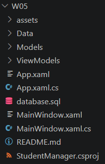
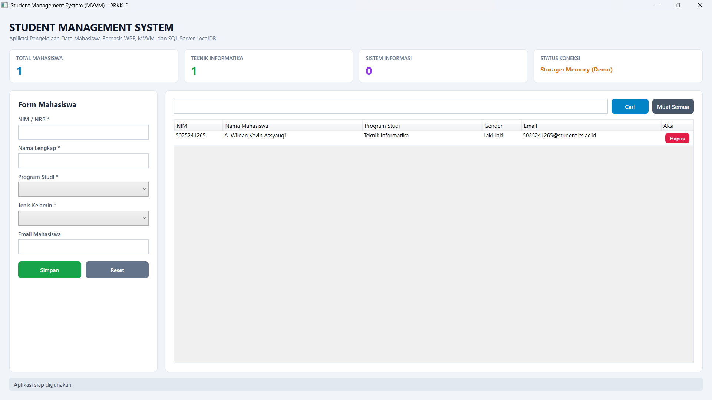
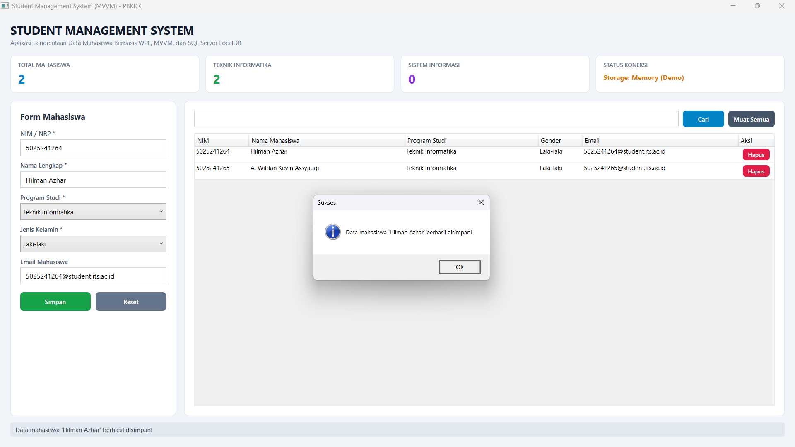
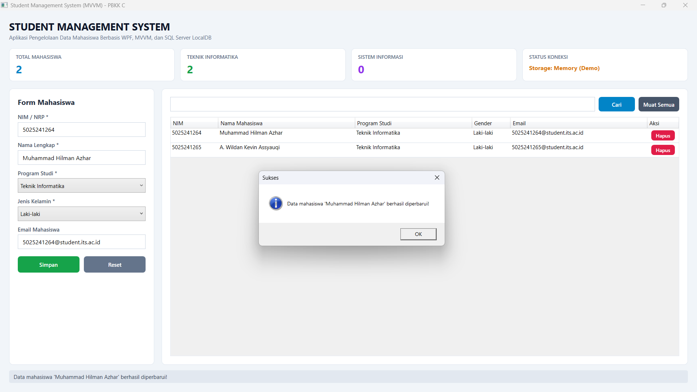
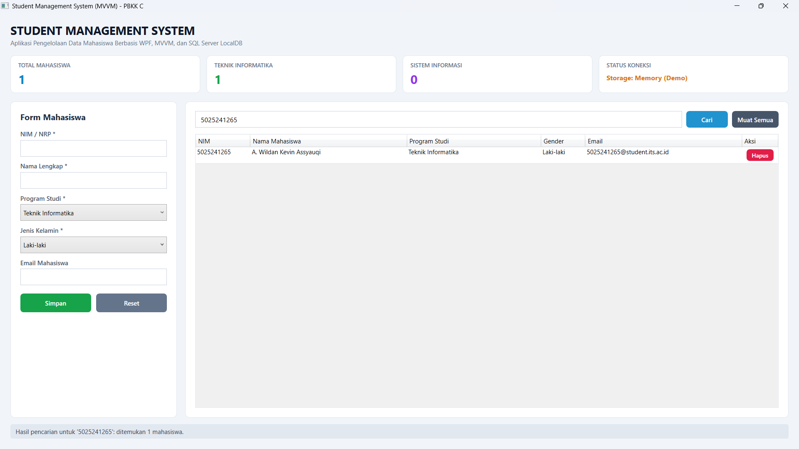
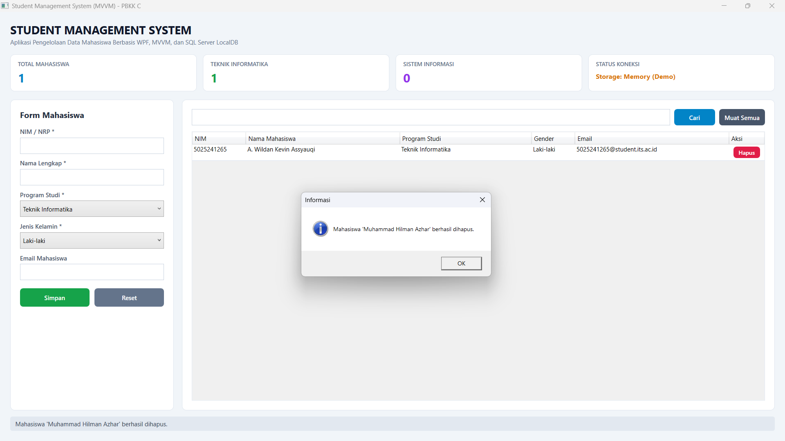

# Tugas 5 - Pemrograman Berbasis Kerangka Kerja C

## Deskripsi
Assalamualaikum Warahmatullahi Wabarakatuh, 

Pada kuliah pertemuan kelima dalam kelas Pemrograman Berbasis Kerangka Kerja kelas C,
Saya mempelajari pengembangan aplikasi desktop tingkat lanjut menggunakan **C#**, **Windows Presentation Foundation (WPF)**, pola arsitektur **MVVM (Model - View - ViewModel)**, konsep **Data Binding**, serta integrasi basis data **SQL Server LocalDB** menggunakan ADO.NET (`Microsoft.Data.SqlClient`). Pada pertemuan ini, mahasiswa ditugaskan untuk membangun aplikasi **Student Management System** yang memungkinkan pengguna untuk menambah, melihat, mengubah, menghapus, mencari data mahasiswa, serta memantau ringkasan statistik data secara *real-time*.

Untuk materi kuliah dapat diakses melalui link [berikut](http://fajarbaskoro.blogspot.com/2021/03/pbkk-windows-presentation-foundation.html) dan [Rich UI Sisma](https://fajarbaskoro.blogspot.com/2026/10/rich-ui-sistem-informasi-mahasiswa-sisma.html).

---

## Langkah Implementasi

### 1. Struktur Proyek Berpola MVVM
Proyek dibangun dengan memisahkan komponen visual (*View*), model data (*Model*), penyedia logika (*ViewModel*), dan pengelola basis data (*Repository*):

```text
W05/
├── assets/
│   └── (tangkapan layar hasil program)
├── Data/
│   └── StudentRepository.cs
├── Models/
│   └── Student.cs
├── ViewModels/
│   ├── RelayCommand.cs
│   └── StudentViewModel.cs
├── App.xaml
├── App.xaml.cs
├── MainWindow.xaml
├── MainWindow.xaml.cs
├── StudentManager.csproj
├── database.sql
└── README.md
```

- **Screenshot Struktur Proyek di Code Editor**
  
  

---

### 2. Konfigurasi Proyek (`StudentManager.csproj`)
Menggunakan target runtime `net8.0-windows` dengan modul `UseWPF` dan library ADO.NET `Microsoft.Data.SqlClient`:
```xml
<Project Sdk="Microsoft.NET.Sdk">

  <PropertyGroup>
    <OutputType>WinExe</OutputType>
    <TargetFramework>net8.0-windows</TargetFramework>
    <Nullable>enable</Nullable>
    <ImplicitUsings>enable</ImplicitUsings>
    <UseWPF>true</UseWPF>
    <RootNamespace>StudentManager</RootNamespace>
  </PropertyGroup>

  <ItemGroup>
    <PackageReference Include="Microsoft.Data.SqlClient" Version="5.2.2" />
  </ItemGroup>

</Project>
```

---

### 3. Skema Basis Data SQL Server LocalDB (`database.sql`)
Skrip SQL untuk membuat basis data `StudentDB` dan tabel `Students`:
```sql
IF DB_ID('StudentDB') IS NULL
    CREATE DATABASE StudentDB;
GO

USE StudentDB;
GO

IF OBJECT_ID('dbo.Students', 'U') IS NULL
BEGIN
    CREATE TABLE dbo.Students
    (
        Id INT IDENTITY(1,1) PRIMARY KEY,
        NIM VARCHAR(20) NOT NULL,
        Nama VARCHAR(100) NOT NULL,
        Jurusan VARCHAR(100) NOT NULL,
        Gender VARCHAR(20) NOT NULL,
        Email VARCHAR(100) NULL
    );

    INSERT INTO dbo.Students (NIM, Nama, Jurusan, Gender, Email)
    VALUES
        ('5025241265', 'A. Wildan Kevin Assyauqi', 'Teknik Informatika', 'Laki-laki', '5025241265@student.its.ac.id');
END;
GO
```

---

### 4. Model Mahasiswa (`Models/Student.cs`)
Merepresentasikan satu entitas data mahasiswa:
```csharp
namespace StudentManager.Models
{
    public class Student
    {
        public int Id { get; set; }
        public string NIM { get; set; } = string.Empty;
        public string Nama { get; set; } = string.Empty;
        public string Jurusan { get; set; } = string.Empty;
        public string Gender { get; set; } = string.Empty;
        public string Email { get; set; } = string.Empty;

        public Student Clone() => new()
        {
            Id = this.Id,
            NIM = this.NIM,
            Nama = this.Nama,
            Jurusan = this.Jurusan,
            Gender = this.Gender,
            Email = this.Email
        };
    }
}
```

---

### 5. Akses Data Repository (`Data/StudentRepository.cs`)
Mengelola koneksi ADO.NET ke SQL Server LocalDB dengan query berparameter (`@keyword`, `@nim`, `@nama`, dll.) untuk mencegah SQL Injection, serta dilengkapi mekanisme *fallback in-memory* otomatis:
```csharp
public List<Student> GetAll(string keyword = "")
{
    using var connection = new SqlConnection(ConnectionString);
    using var command = new SqlCommand(
        "SELECT Id, NIM, Nama, Jurusan, Gender, Email FROM Students " +
        "WHERE NIM LIKE @keyword OR Nama LIKE @keyword OR Jurusan LIKE @keyword ORDER BY Id DESC",
        connection);

    command.Parameters.Add("@keyword", SqlDbType.VarChar, 100).Value = $"%{keyword}%";
    connection.Open();
    using var reader = command.ExecuteReader();
    var list = new List<Student>();
    while (reader.Read())
    {
        list.Add(new Student
        {
            Id = reader.GetInt32(0),
            NIM = reader.GetString(1),
            Nama = reader.GetString(2),
            Jurusan = reader.GetString(3),
            Gender = reader.GetString(4),
            Email = reader.IsDBNull(5) ? "" : reader.GetString(5)
        });
    }
    return list;
}
```

---

### 6. Lapisan ViewModel (`ViewModels/StudentViewModel.cs`)
Mengimplementasikan antarmuka `INotifyPropertyChanged` dan `ICommand` (`RelayCommand`) untuk menghubungkan logika bisnis dengan tampilan secara deklaratif:
- **`Students`**: `ObservableCollection<Student>` untuk pembaharuan otomatis pada tabel data.
- **`CurrentStudent`**: Objek yang terikat pada formulir input.
- **`SelectedStudent`**: Objek terpilih pada `DataGrid` yang otomatis mengisi formulir untuk mode pembaruan (*Update*).
- **Statistik Dinamis**: Menghitung `TotalStudents`, `TotalInformatika`, `TotalSistemInformasi`, dan status koneksi database.

---

### 7. Desain Antarmuka GUI (`MainWindow.xaml`)
Menyediakan antarmuka modern yang terdiri dari:
1. **Header & Kartu Ringkasan Statistik** di bagian atas.
2. **Formulir Input Mahasiswa** di sisi kiri dengan validasi kelengkapan data.
3. **Pencarian Data & Tabel DataGrid** di sisi kanan dilengkapi tombol aksi hapus pada setiap baris.
4. **Status Bar** di bagian bawah untuk menampilkan umpan balik aksi pengguna.

---

## Preview dan Hasil Eksekusi

Berikut adalah tangkapan layar hasil pengujian aplikasi Student Management System:

### 1. Tampilan Utama Aplikasi
Tampilan antarmuka awal yang memuat kartu statistik ringkasan data, form input, dan tabel data mahasiswa pada `DataGrid`.



### 2. Tambah Data Mahasiswa (Create)
Pengisian form dengan data mahasiswa baru, data berhasil disimpan ke database, serta kartu statistik bertambah secara otomatis.



### 3. Ubah Data Mahasiswa (Update)
Memilih baris mahasiswa pada `DataGrid` untuk mengisi form input secara otomatis, mengubah informasi, dan menyimpan pembaruan.



### 4. Pencarian Data Mahasiswa (Search)
Menyaring data mahasiswa di `DataGrid` menggunakan kata kunci pada kotak pencarian (pencarian berdasarkan NIM, nama, atau program studi).



### 5. Hapus Data Mahasiswa (Delete)
Menghapus data mahasiswa terpilih melalui tombol Hapus dengan konfirmasi dialog, serta pembaruan data pada tabel dan statistik.



Terimakasih.

---

## Identitas
- **Nama**   : A. Wildan Kevin Assyauqi  
- **NRP**    : 5025241265  
- **Kelas**  : Pemrograman Berbasis Kerangka Kerja - C
