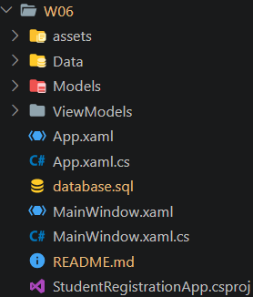
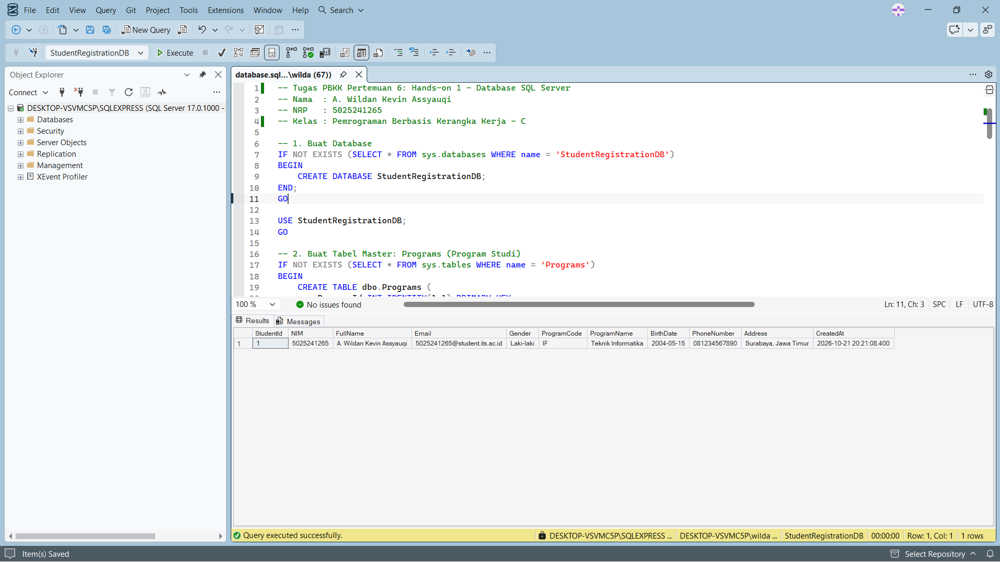
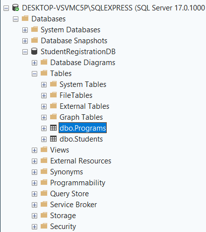
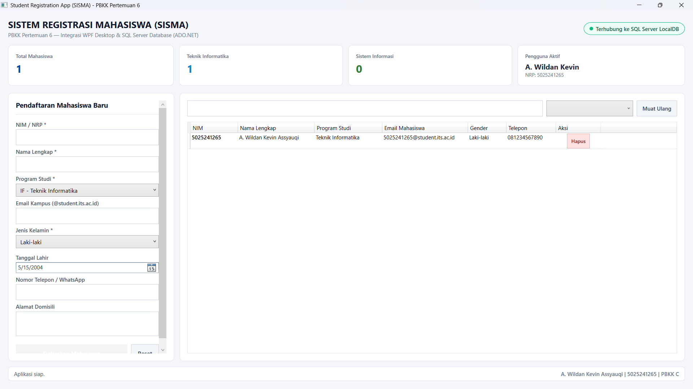
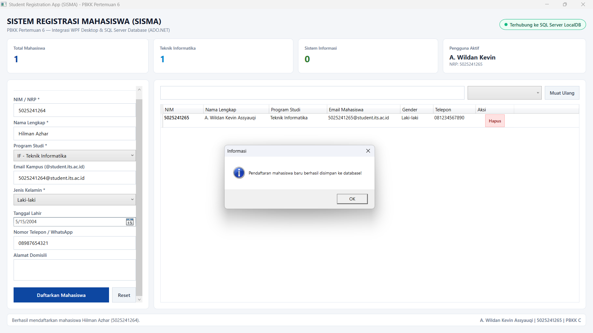
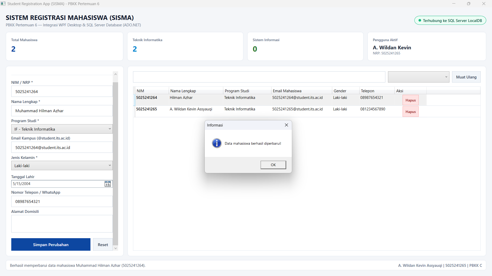
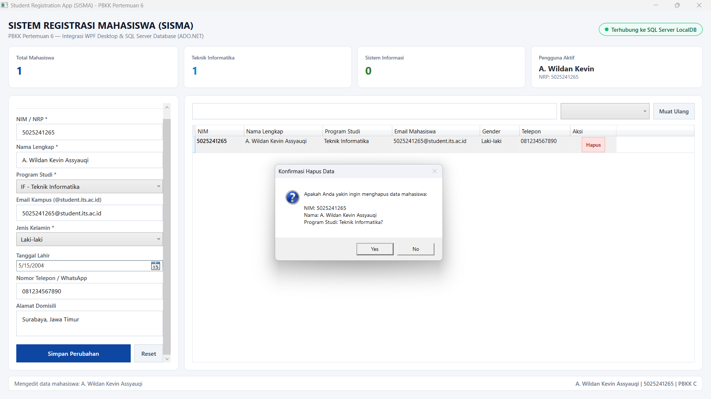
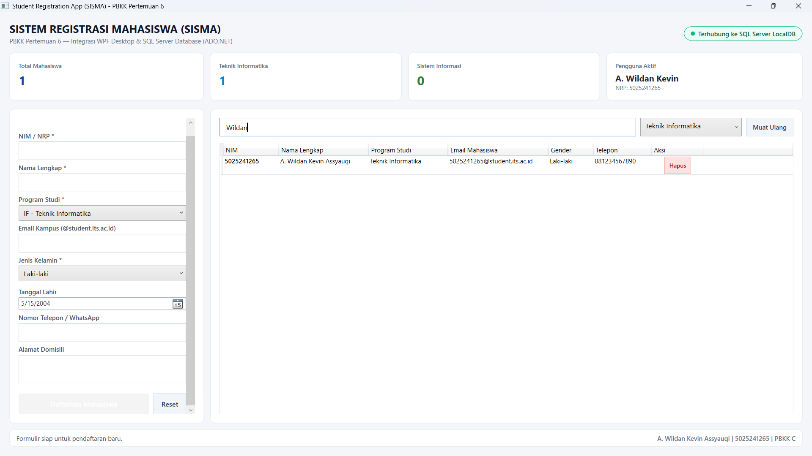

# Tugas Pertemuan 6 - SQL Server & Integrasi WPF ADO.NET

Dokumentasi tugas pemrograman mingguan mata kuliah **Pemrograman Berbasis Kerangka Kerja (PBKK) Kelas C - 2026**, Departemen Teknik Informatika, Fakultas Teknologi Elektro dan Informatika Cerdas, Institut Teknologi Sepuluh Nopember Surabaya.

---

## Deskripsi

Tugas pertemuan ke-6 ini berfokus pada integrasi basis data relasional **Microsoft SQL Server** dengan aplikasi desktop berbasis **Windows Presentation Foundation (WPF)** menggunakan pustaka konektivitas **ADO.NET** (`Microsoft.Data.SqlClient`). 

Pengerjaan tugas ini terbagi menjadi dua bagian utama:
1. **Hands-on 1 — Membuat Database dengan SQL Server:**
   - Merancang basis data relasional `StudentRegistrationDB`.
   - Membuat tabel master `Programs` (Program Studi) dan tabel transaksi `Students` (Pendaftaran Mahasiswa) dengan relasi *One-to-Many* ($1:N$).
   - Menerapkan batasan integritas data (*Primary Key*, *Foreign Key*, *Unique Constraint*, *Default Values*).
   - Memasukkan data awal (*seed data*) dan menguji relasi antar tabel menggunakan kueri `INNER JOIN`.

2. **Hands-on 2 — Integrasi WPF dengan SQL Server menggunakan ADO.NET:**
   - Membangun aplikasi desktop modern menggunakan C# dan .NET 8 WPF.
   - Menghubungkan antarmuka grafis ke SQL Server melalui arsitektur terpisah *Repository Pattern* dan pola desain **MVVM (Model-View-ViewModel)**.
   - Mengimplementasikan operasi lengkap CRUD (*Create, Read, Update, Delete*) serta fitur pencarian data secara *real-time*.
   - Menyediakan mekanisme *fallback in-memory* otomatis untuk memastikan kestabilan eksekusi aplikasi pada berbagai lingkungan pengembangan.

---

## Struktur Proyek

```text
W06/
├── assets/
│   ├── 00_struktur_project.png
│   ├── 01_database_setup.png
│   ├── 02_object_explorer_tabel.png
│   ├── 03_tampilan_utama.png
│   ├── 04_tambah_data.png
│   ├── 05_update_data.png
│   ├── 06_hapus_data.png
│   └── 07_pencarian_filter.png
├── Data/
│   └── StudentRepository.cs
├── Models/
│   ├── ProgramStudy.cs
│   └── Student.cs
├── ViewModels/
│   ├── RelayCommand.cs
│   └── StudentViewModel.cs
├── App.xaml
├── App.xaml.cs
├── MainWindow.xaml
├── MainWindow.xaml.cs
├── StudentRegistrationApp.csproj
├── database.sql
└── README.md
```

- **Screenshot Struktur Proyek di Code Editor**

  

---

## Hands-on 1: Membuat Database dengan SQL Server

### 1. Perancangan Skema Database
Basis data `StudentRegistrationDB` dirancang dengan relasi $1:N$ antara tabel `Programs` dan `Students`:
- Satu Program Studi dapat memiliki banyak mahasiswa yang mendaftar.
- Satu mahasiswa wajib terdaftar pada tepat satu Program Studi.

```text
+-----------------------+              +------------------------------+
|     dbo.Programs      |              |         dbo.Students         |
+-----------------------+              +------------------------------+
| PK  ProgramId (INT)   |<-------+     | PK  StudentId (INT)          |
|     ProgramCode (U)   |        |     |     NIM (VARCHAR 20, UNIQUE) |
|     ProgramName       |        +---- | FK  ProgramId (INT)          |
|     IsActive (BIT)    |              |     FullName (NVARCHAR 150)  |
|     CreatedAt         |              |     Email (VARCHAR 100)      |
+-----------------------+              |     Gender (NVARCHAR 20)     |
                                       |     BirthDate (DATE)         |
                                       |     PhoneNumber (VARCHAR 25) |
                                       |     Address (NVARCHAR 255)   |
                                       |     CreatedAt (DATETIME)     |
                                       +------------------------------+
```

### 2. Skrip DDL & DML Database (`database.sql`)
Berikut adalah implementasi skrip SQL untuk pembuatan basis data, tabel, relasi referensial, dan data benih (*seed data*):

```sql
-- 1. Buat Database
IF NOT EXISTS (SELECT * FROM sys.databases WHERE name = 'StudentRegistrationDB')
BEGIN
    CREATE DATABASE StudentRegistrationDB;
END;
GO

USE StudentRegistrationDB;
GO

-- 2. Buat Tabel Master: Programs (Program Studi)
IF NOT EXISTS (SELECT * FROM sys.tables WHERE name = 'Programs')
BEGIN
    CREATE TABLE dbo.Programs (
        ProgramId INT IDENTITY(1,1) PRIMARY KEY,
        ProgramCode VARCHAR(20) UNIQUE NOT NULL,
        ProgramName NVARCHAR(100) NOT NULL,
        IsActive BIT NOT NULL DEFAULT 1,
        CreatedAt DATETIME NOT NULL DEFAULT GETDATE()
    );
END;
GO

-- 3. Buat Tabel Transaksi / Anak: Students (Pendaftaran Mahasiswa)
IF NOT EXISTS (SELECT * FROM sys.tables WHERE name = 'Students')
BEGIN
    CREATE TABLE dbo.Students (
        StudentId INT IDENTITY(1,1) PRIMARY KEY,
        NIM VARCHAR(20) UNIQUE NOT NULL,
        FullName NVARCHAR(150) NOT NULL,
        Email VARCHAR(100) NOT NULL,
        Gender NVARCHAR(20) NOT NULL,
        BirthDate DATE NULL,
        PhoneNumber VARCHAR(25) NULL,
        Address NVARCHAR(255) NULL,
        ProgramId INT NOT NULL,
        CreatedAt DATETIME NOT NULL DEFAULT GETDATE(),
        CONSTRAINT FK_Students_Programs FOREIGN KEY (ProgramId)
            REFERENCES dbo.Programs(ProgramId)
            ON UPDATE CASCADE
            ON DELETE NO ACTION
    );
END;
GO

-- 4. Seeding Data Master: Programs
IF NOT EXISTS (SELECT 1 FROM dbo.Programs)
BEGIN
    INSERT INTO dbo.Programs (ProgramCode, ProgramName, IsActive)
    VALUES
        ('IF', 'Teknik Informatika', 1),
        ('SI', 'Sistem Informasi', 1),
        ('TE', 'Teknik Elektro', 1),
        ('TI', 'Teknik Industri', 1),
        ('TS', 'Teknik Sipil', 1);
END;
GO

-- 5. Seeding Data Mahasiswa (Hanya Data Wildan Sesuai Ketentuan)
IF NOT EXISTS (SELECT 1 FROM dbo.Students)
BEGIN
    DECLARE @ProgramIF INT = (SELECT TOP 1 ProgramId FROM dbo.Programs WHERE ProgramCode = 'IF');

    INSERT INTO dbo.Students (NIM, FullName, Email, Gender, BirthDate, PhoneNumber, Address, ProgramId)
    VALUES
        ('5025241265', 'A. Wildan Kevin Assyauqi', '5025241265@student.its.ac.id', 'Laki-laki', '2004-05-15', '081234567890', 'Surabaya, Jawa Timur', @ProgramIF);
END;
GO
```

### 3. Pengujian Relasi Menggunakan Kueri `INNER JOIN`
Kueri ini digunakan untuk menggabungkan data mahasiswa dengan nama program studi secara otomatis:

```sql
SELECT 
    s.StudentId,
    s.NIM,
    s.FullName,
    s.Email,
    s.Gender,
    p.ProgramCode,
    p.ProgramName,
    s.BirthDate,
    s.PhoneNumber,
    s.Address,
    s.CreatedAt
FROM dbo.Students s
INNER JOIN dbo.Programs p ON s.ProgramId = p.ProgramId;
GO
```

---

## Hands-on 2: Integrasi WPF dengan SQL Server menggunakan ADO.NET

### 1. Konfigurasi Dependensi Proyek (`StudentRegistrationApp.csproj`)
Proyek dikonfigurasi menggunakan target runtime Windows (`net8.0-windows`) dan memanfaatkan pustaka resmi `Microsoft.Data.SqlClient`:

```xml
<Project Sdk="Microsoft.NET.Sdk">

  <PropertyGroup>
    <OutputType>WinExe</OutputType>
    <TargetFramework>net8.0-windows</TargetFramework>
    <Nullable>enable</Nullable>
    <ImplicitUsings>enable</ImplicitUsings>
    <UseWPF>true</UseWPF>
    <RootNamespace>StudentRegistrationApp</RootNamespace>
    <AssemblyName>StudentRegistrationApp</AssemblyName>
  </PropertyGroup>

  <ItemGroup>
    <PackageReference Include="Microsoft.Data.SqlClient" Version="5.2.2" />
  </ItemGroup>

</Project>
```

---

### 2. Model Data (`Models/ProgramStudy.cs` & `Models/Student.cs`)

- **ProgramStudy.cs:** Merepresentasikan entitas program studi untuk pengisian dropdown ComboBox.
```csharp
namespace StudentRegistrationApp.Models
{
    public class ProgramStudy
    {
        public int ProgramId { get; set; }
        public string ProgramCode { get; set; } = string.Empty;
        public string ProgramName { get; set; } = string.Empty;
        public bool IsActive { get; set; } = true;

        public string DisplayName => $"{ProgramCode} - {ProgramName}";
    }
}
```

- **Student.cs:** Merepresentasikan entitas mahasiswa lengkap dengan foreign key `ProgramId` dan properti hasil relasi `ProgramName`:
```csharp
namespace StudentRegistrationApp.Models
{
    public class Student
    {
        public int StudentId { get; set; }
        public string NIM { get; set; } = string.Empty;
        public string FullName { get; set; } = string.Empty;
        public string Email { get; set; } = string.Empty;
        public string Gender { get; set; } = string.Empty;
        public DateTime? BirthDate { get; set; } = DateTime.Today.AddYears(-20);
        public string PhoneNumber { get; set; } = string.Empty;
        public string Address { get; set; } = string.Empty;
        public int ProgramId { get; set; }
        public string ProgramName { get; set; } = string.Empty;
        public DateTime CreatedAt { get; set; } = DateTime.Now;

        public Student Clone() => new()
        {
            StudentId = this.StudentId,
            NIM = this.NIM,
            FullName = this.FullName,
            Email = this.Email,
            Gender = this.Gender,
            BirthDate = this.BirthDate,
            PhoneNumber = this.PhoneNumber,
            Address = this.Address,
            ProgramId = this.ProgramId,
            ProgramName = this.ProgramName,
            CreatedAt = this.CreatedAt
        };
    }
}
```

---

### 3. Akses Data ADO.NET Repository (`Data/StudentRepository.cs`)
Kelas repositori bertugas menangani seluruh interaksi basis data menggunakan `SqlConnection`, `SqlCommand`, dan `SqlDataReader` dengan kueri berparameter (*Parameterized Queries*) untuk mencegah SQL Injection:

```csharp
public List<Student> GetAllStudents(string keyword = "", int? programIdFilter = null)
{
    // ... Koneksi dan eksekusi query parameterized INNER JOIN
    string sql = @"
        SELECT 
            s.StudentId, s.NIM, s.FullName, s.Email, s.Gender, 
            s.BirthDate, s.PhoneNumber, s.Address, s.ProgramId, 
            p.ProgramName, s.CreatedAt
        FROM dbo.Students s
        INNER JOIN dbo.Programs p ON s.ProgramId = p.ProgramId
        WHERE (@kw = '' OR s.NIM LIKE @kwLike OR s.FullName LIKE @kwLike OR s.Email LIKE @kwLike OR p.ProgramName LIKE @kwLike)
          AND (@progId IS NULL OR s.ProgramId = @progId)
        ORDER BY s.StudentId DESC;";
    // ...
}
```

---

### 4. ViewModel MVVM (`ViewModels/StudentViewModel.cs`)
Mengatur logika antarmuka secara reaktif menggunakan antarmuka `INotifyPropertyChanged`:
- **`Students`**: Koleksi data mahasiswa yang terikat langsung ke `DataGrid`.
- **`Programs` & `GenderList`**: Koleksi pilihan program studi dan jenis kelamin untuk kontrol input.
- **`SelectedStudent`**: Deteksi pemilihan baris tabel untuk pengisian formulir mode edit secara otomatis.
- **`SaveCommand`, `DeleteCommand`, `ResetFormCommand`, `SearchCommand`**: Perintah eksekusi operasi basis data dengan notifikasi dialog konfirmasi.
- **Statistik Dinamis**: Menghitung total pendaftar per jurusan dan status konektivitas basis data.

---

### 5. Desain Antarmuka Pengguna XAML (`MainWindow.xaml`)
Antarmuka pengguna didesain dengan konsep **Rich UI** yang terbagi dalam komponen terstruktur:
1. **Header & Status Server:** Menampilkan judul sistem dan badge status koneksi SQL Server.
2. **Kartu Statistik Ringkasan:** Menampilkan total mahasiswa terdaftar, mahasiswa jurusan Teknik Informatika, dan ringkasan pengguna aktif.
3. **Formulir Pendaftaran (Kiri):** Input form terstruktur dengan validasi data, pemilihan jurusan via ComboBox, date picker tanggal lahir, dan tombol aksi.
4. **Tabel Data & Pencarian (Kanan):** Filter instan dan `DataGrid` interaktif yang menampilkan relasi program studi serta tombol aksi cepat per baris data.
5. **Status Bar (Bawah):** Informasi riwayat aksi operasional sistem.

---

## Preview dan Hasil Eksekusi

Berikut adalah tangkapan layar pengujian yang dibagi berdasarkan masing-masing bagian *Hands-on*:

---

### Bagian 1 — Hands-on 1: Database SQL Server

#### 1. Eksekusi Skrip SQL & Pengujian Kueri INNER JOIN
Eksekusi file skrip `database.sql` di SQL Server Management Studio (SSMS) yang berhasil membuat database `StudentRegistrationDB`, membuat tabel `Programs` dan `Students`, melakukan *seeding* data awal, serta menampilkan hasil kueri relasi `INNER JOIN`.



#### 2. Struktur Tabel & Database di Object Explorer
Tampilan hierarki database pada panel *Object Explorer* di SSMS yang memperlihatkan tabel master `dbo.Programs`, tabel relasi `dbo.Students`, serta kolom dan *keys* yang telah terbentuk.



---

### Bagian 2 — Hands-on 2: Integrasi WPF Desktop & ADO.NET

#### 1. Tampilan Utama Aplikasi (Read / Display Data)
Tampilan awal saat aplikasi dijalankan, memuat status koneksi database, kartu ringkasan data, formulir pendaftaran di sisi kiri, dan data awal mahasiswa yang ditarik dari SQL Server pada `DataGrid`.



#### 2. Pendaftaran Mahasiswa Baru (Create)
Pengisian formulir pendaftaran mahasiswa baru dengan memilih program studi dari dropdown relasional, data berhasil tersimpan ke dalam tabel database SQL Server via ADO.NET.



#### 3. Pembaruan Data Mahasiswa (Update)
Memilih baris mahasiswa pada `DataGrid` untuk mengisi formulir input secara otomatis, melakukan perubahan informasi, dan menyimpan pembaruan ke database.



#### 4. Penghapusan Data Mahasiswa (Delete)
Menghapus data mahasiswa dari database melalui tombol Hapus pada baris tabel yang dilengkapi dialog konfirmasi keamanan data.



#### 5. Pencarian dan Filter Data (Search / Filter)
Penyaringan data mahasiswa secara interaktif berdasarkan kata kunci (NIM, Nama, Email) maupun filter spesifik program studi.



Terimakasih.

---

## Identitas
- **Nama**   : A. Wildan Kevin Assyauqi  
- **NRP**    : 5025241265  
- **Kelas**  : Pemrograman Berbasis Kerangka Kerja - C
