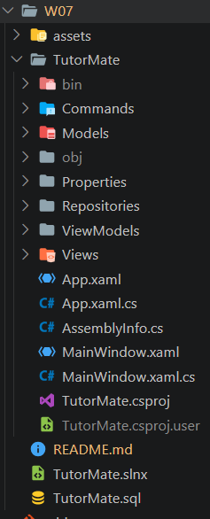

# Tugas Pertemuan 7 - TutorMate: Aplikasi Manajemen Tutor Akademik (PRD & Implementasi Awal)

Dokumentasi tugas pemrograman kelompok mata kuliah **Pemrograman Berbasis Kerangka Kerja (PBKK) Kelas C - 2026**, Departemen Teknik Informatika, Fakultas Teknologi Elektro dan Informatika Cerdas, Institut Teknologi Sepuluh Nopember Surabaya.

---

## Deskripsi

**TutorMate** adalah aplikasi desktop berbasis **Windows Presentation Foundation (WPF)** dengan **C# (.NET)** yang dirancang untuk mengelola ekosistem layanan tutor akademik sebaya di lingkungan kampus. Aplikasi ini memfasilitasi mahasiswa yang menguasai mata kuliah tertentu untuk mendaftar sebagai tutor (mentor), serta memungkinkan mahasiswa lain (peserta) untuk menjelajahi katalog mata kuliah dan mengajukan sesi belajar.

Pada pertemuan ke-7 ini, fokus pengerjaan mencakup:
1. **Penyusunan Product Requirements Document (PRD):**
   - Merumuskan visi produk, latar belakang, analisis pengguna, dan matriks hak akses (*Peserta* dan *Mentor*).
   - Menetapkan kebutuhan fungsional (FR), kebutuhan non-fungsional (NFR), aturan bisnis, siklus status pengajuan tutor, dan panduan *design system* antarmuka *Rich UI*.
2. **Perancangan Basis Data Relasional SQL Server (`TutorMateDB`):**
   - Membuat tabel master mata kuliah (`Subjects`), tabel pengguna dan peran (`Users`), serta tabel transaksi pendataan tutor (`TutorApplications`) yang saling terhubung melalui relasi *Foreign Key*.
3. **Implementasi Awal Aplikasi Desktop WPF:**
   - Membangun modul autentikasi: antarmuka Login (`LoginWindow.xaml`) dan Registrasi Pengguna (`RegisterWindow.xaml`).
   - Menyediakan Dashboard Utama (`MainWindow.xaml`) dengan navigasi *sidebar*, katalog mata kuliah, daftar tutor terdaftar, serta formulir pendaftaran tutor dan penambahan mata kuliah.
   - Menggunakan pemisahan arsitektur *Repository Pattern* (`UserRepository.cs`, `TutorRepository.cs`, `DatabaseConfig.cs`) untuk konektivitas ADO.NET yang fleksibel ke SQL Server.

---

## Tautan Dokumen & Repositori

| No | Komponen | Keterangan / Tautan |
| :-: | :--- | :--- |
| 1 | **Product Requirements Document (PRD)** | [Google Docs - PRD TutorMate Kelompok 8](https://docs.google.com/document/d/1uZbdgMPmGHO2TZzvQ9n4VjdaaDinSiKx4SfpOjJBlLM/edit?tab=t.0) |
| 2 | **Kode Sumber Aplikasi** | [GitHub - PBKK/W07](https://github.com/wildankev/PBKK/tree/main/W07) |
| 3 | **Video Dokumentasi & Demo** | [Tautan Video Demo Aplikasi (YouTube / Drive)](https://youtu.be/placeholder_video_tutormate) |

---

## Struktur Proyek

```text
W07/
├── assets/
│   ├── 00_struktur_project.png
│   ├── 01_database_setup.png
│   ├── 02_login_window.png
│   ├── 03_register_window.png
│   ├── 04_dashboard_list_tutor.png
│   ├── 05_katalog_mata_kuliah.png
│   ├── 06_form_daftar_tutor.png
│   └── 07_form_tambah_mk.png
├── TutorMate/
│   ├── Commands/
│   │   └── RelayCommand.cs
│   ├── Models/
│   │   ├── Subject.cs
│   │   ├── TutorApplication.cs
│   │   └── User.cs
│   ├── Repositories/
│   │   ├── DatabaseConfig.cs
│   │   ├── TutorRepository.cs
│   │   └── UserRepository.cs
│   ├── ViewModels/
│   │   └── MainViewModel.cs
│   ├── Views/
│   │   ├── LoginWindow.xaml
│   │   ├── LoginWindow.xaml.cs
│   │   ├── RegisterWindow.xaml
│   │   └── RegisterWindow.xaml.cs
│   ├── App.xaml
│   ├── App.xaml.cs
│   ├── AssemblyInfo.cs
│   ├── MainWindow.xaml
│   ├── MainWindow.xaml.cs
│   └── TutorMate.csproj
├── TutorMate.slnx
├── TutorMate.sql
└── README.md
```

- **Screenshot Struktur Proyek di Code Editor**

  

---

## Ringkasan Product Requirements Document (PRD)

Dokumen PRD lengkap dapat diakses melalui tautan berikut:
- **Tautan Google Docs:** [Google Docs - PRD TutorMate Kelompok 8](https://docs.google.com/document/d/1uZbdgMPmGHO2TZzvQ9n4VjdaaDinSiKx4SfpOjJBlLM/edit?tab=t.0)

### 1. Peran Pengguna dan Hak Akses
| Peran | Deskripsi | Hak Akses Utama |
| :--- | :--- | :--- |
| **Peserta (Mentee)** | Mahasiswa yang mencari bimbingan belajar | Registrasi, Login, melihat katalog mata kuliah, melihat daftar tutor, mengajukan diri menjadi tutor |
| **Mentor (Tutor)** | Mahasiswa yang memberikan bimbingan | Login, melihat daftar tutor, mendaftarkan mata kuliah baru, mengelola topik keahlian dan jadwal bimbingan |

### 2. Kebutuhan Fungsional Utama
- **FR-01 (Autentikasi & Akun):** Pendaftaran akun baru dengan validasi keunikan NIM, enkripsi/validasi kata sandi, dan pemilihan peran awal.
- **FR-02 (Katalog Mata Kuliah):** Menampilkan daftar mata kuliah yang tersedia beserta kode MK dan deskripsi bidang kompetensi.
- **FR-03 (Manajemen Tutor):** Pendataan tutor per mata kuliah dilengkapi dengan nilai riwayat akademis, topik keahlian khusus, dan preferensi jadwal.
- **FR-04 (Antarmuka Rich UI):** Mengadaptasi konsep antarmuka modern dengan navigasi sidebar responsif, visualisasi tabel data (*DataGrid*), dan umpan balik aksi pengguna.

---

## Perancangan Basis Data SQL Server (`TutorMateDB`)

Skrip SQL lengkap tersedia pada file [TutorMate.sql](TutorMate.sql).

### 1. Skema Tabel Relasional
```text
+-----------------------+              +------------------------------+              +-----------------------+
|     dbo.Subjects      |              |    dbo.TutorApplications     |              |       dbo.Users       |
+-----------------------+              +------------------------------+              +-----------------------+
| PK  SubjectId (INT)   |<-------+     | PK  ApplicationId (INT)      |     +------->| PK  UserId (INT)      |
|     KodeMK (VARCHAR)  |        |     | FK  SubjectId (INT)          |     |        |     NIM (VARCHAR, U)  |
|     NamaMataKuliah    |        +---- | FK  TutorId (INT)            |-----+        |     Nama (VARCHAR)    |
|     Deskripsi         |              |     NilaiHuruf (VARCHAR)     |              |     Password (VARCHAR)|
+-----------------------+              |     HariJadwal (VARCHAR)     |              |     Role (VARCHAR)    |
                                       |     TopikKeahlian (VARCHAR)  |              +-----------------------+
                                       +------------------------------+
```

### 2. Skrip DDL & DML (`TutorMate.sql`)
```sql
-- Inisialisasi Database
IF NOT EXISTS (SELECT * FROM sys.databases WHERE name = 'TutorMateDB')
BEGIN
    CREATE DATABASE [TutorMateDB];
END;
GO

USE [TutorMateDB];
GO

-- Tabel Subjects
CREATE TABLE [dbo].[Subjects](
    [SubjectId] [int] IDENTITY(1,1) PRIMARY KEY,
    [KodeMK] [varchar](20) NOT NULL,
    [NamaMataKuliah] [varchar](100) NOT NULL,
    [Deskripsi] [varchar](255) NULL
);

-- Tabel Users
CREATE TABLE [dbo].[Users](
    [UserId] [int] IDENTITY(1,1) PRIMARY KEY,
    [NIM] [varchar](20) UNIQUE NOT NULL,
    [Nama] [varchar](100) NOT NULL,
    [Password] [varchar](100) NOT NULL,
    [Role] [varchar](20) NOT NULL
);

-- Tabel TutorApplications
CREATE TABLE [dbo].[TutorApplications](
    [ApplicationId] [int] IDENTITY(1,1) PRIMARY KEY,
    [TutorId] [int] NOT NULL,
    [SubjectId] [int] NOT NULL,
    [NilaiHuruf] [varchar](5) NOT NULL,
    [HariJadwal] [varchar](100) NOT NULL,
    [TopikKeahlian] [varchar](255) NULL,
    CONSTRAINT FK_TutorApplications_Users FOREIGN KEY ([TutorId]) REFERENCES [dbo].[Users] ([UserId]) ON DELETE CASCADE,
    CONSTRAINT FK_TutorApplications_Subjects FOREIGN KEY ([SubjectId]) REFERENCES [dbo].[Subjects] ([SubjectId]) ON DELETE CASCADE
);
```

---

## Implementasi Aplikasi Desktop WPF

### 1. Konfigurasi Proyek (`TutorMate/TutorMate.csproj`)
Dikonfigurasi dengan target runtime Windows Desktop (.NET 8.0-windows) serta pustaka resmi ADO.NET `Microsoft.Data.SqlClient`:

```xml
<Project Sdk="Microsoft.NET.Sdk">

  <PropertyGroup>
    <OutputType>WinExe</OutputType>
    <TargetFramework>net8.0-windows</TargetFramework>
    <Nullable>enable</Nullable>
    <ImplicitUsings>enable</ImplicitUsings>
    <UseWPF>true</UseWPF>
  </PropertyGroup>

  <ItemGroup>
    <PackageReference Include="Microsoft.Data.SqlClient" Version="5.2.2" />
  </ItemGroup>

</Project>
```

### 2. Fleksibilitas Konektivitas Database (`DatabaseConfig.cs`)
Untuk memastikan aplikasi dapat berjalan mulus pada lingkungan lokal pengembang manapun tanpa modifikasi manual, kelas `DatabaseConfig` secara otomatis menguji kandidat instance SQL Server yang aktif:
- `localhost\SQLEXPRESS`
- `.\SQLEXPRESS`
- `localhost`
- `(localdb)\MSSQLLocalDB`

### 3. Modul Autentikasi (`Views/LoginWindow.xaml` & `Views/RegisterWindow.xaml`)
- **LoginWindow:** Memvalidasi kredensial pengguna (NIM dan Password) terhadap database via `UserRepository.Authenticate()`. Pengguna yang berhasil login akan dialihkan ke jendela utama dengan profil perannya.
- **RegisterWindow:** Formulir pendaftaran akun baru dengan memilih peran awal (*Peserta* atau *Mentor*).

### 4. Dashboard Utama (`MainWindow.xaml`)
Menyediakan tata letak *Rich UI* dengan navigasi menu dinamis:
- **List Tutor:** Menampilkan tabel `DataGrid` tutor aktif hasil `JOIN` antara data profil pengguna, mata kuliah, jadwal, dan nilai akademik.
- **Katalog Mata Kuliah:** Menampilkan daftar mata kuliah yang tersedia untuk bimbingan akademik.
- **Form Pendaftaran Tutor:** Memungkinkan mahasiswa mendaftar menjadi tutor untuk mata kuliah pilihan.
- **Form Tambah Mata Kuliah:** Memungkinkan mentor mengusulkan mata kuliah baru ke dalam sistem.

---

## Cara Menjalankan Proyek

1. **Persiapan Database:**
   - Buka SQL Server Management Studio (SSMS).
   - Buka dan jalankan file [W07/TutorMate.sql](TutorMate.sql) (tekan **F5**).
   - Database `TutorMateDB` beserta data awal akan otomatis terbuat.

2. **Menjalankan Aplikasi Desktop:**
   Buka terminal PowerShell dan jalankan perintah berikut:
   ```powershell
   cd D:\Coolyeah\Semester5\pbkk\W07\TutorMate
   dotnet run
   ```

3. **Akun Uji Coba Default (Kelompok 8):**
   - **Mentor:** NIM `5025241265` | Password `1234`
   - **Mentor:** NIM `5025241264` | Password `1234`
   - **Peserta:** NIM `5025241248` | Password `1234`

---

## Preview dan Hasil Eksekusi

Berikut adalah tangkapan layar pengujian sistem aplikasi TutorMate:

### 1. Eksekusi Skrip Basis Data & Setup SSMS
Pembuatan database `TutorMateDB`, skema relasional tabel `Subjects`, `Users`, dan `TutorApplications`, serta kueri verifikasi `INNER JOIN` di SQL Server Management Studio.


### 2. Antarmuka Login Pengguna (Authentication)
Formulir autentikasi pengguna menggunakan NIM dan kata sandi untuk masuk ke dalam sistem.


### 3. Pendaftaran Akun Baru (Registration)
Formulir pembuatan akun baru mahasiswa dengan memilih peran pengguna (*Peserta* atau *Mentor*).


### 4. Dashboard Utama - Menu List Tutor
Tampilan tabel daftar tutor terdaftar yang memuat nama tutor, mata kuliah bimbingan, jadwal, dan topik keahlian.


### 5. Dashboard Utama - Katalog Mata Kuliah
Tampilan katalog mata kuliah yang tersedia di dalam sistem beserta kode mata kuliah dan deskripsinya.


### 6. Formulir Pendaftaran Tutor Baru
Halaman formulir bagi mahasiswa untuk mendaftarkan diri menjadi tutor pada mata kuliah tertentu beserta pilihan jadwal.


### 7. Formulir Tambah Mata Kuliah Baru
Halaman formulir penambahan mata kuliah baru ke dalam katalog sistem yang dapat diakses oleh mentor.


Terimakasih.

---

## Identitas Kelompok
- **Mata Kuliah** : Pemrograman Berbasis Kerangka Kerja (C)
- **Kelompok**    : 8 (Delapan)
- **Anggota Kelompok**:
  1. Muhammad Hilman Azhar (NRP: 5025241264)
  2. A. Wildan Kevin Assyauqi (NRP: 5025241265)
  3. Al Jad Kaukabudduri Hardianto (NRP: 5025241248)
- **Departemen**  : Teknik Informatika, Fakultas Teknologi Elektro dan Informatika Cerdas, Institut Teknologi Sepuluh Nopember
