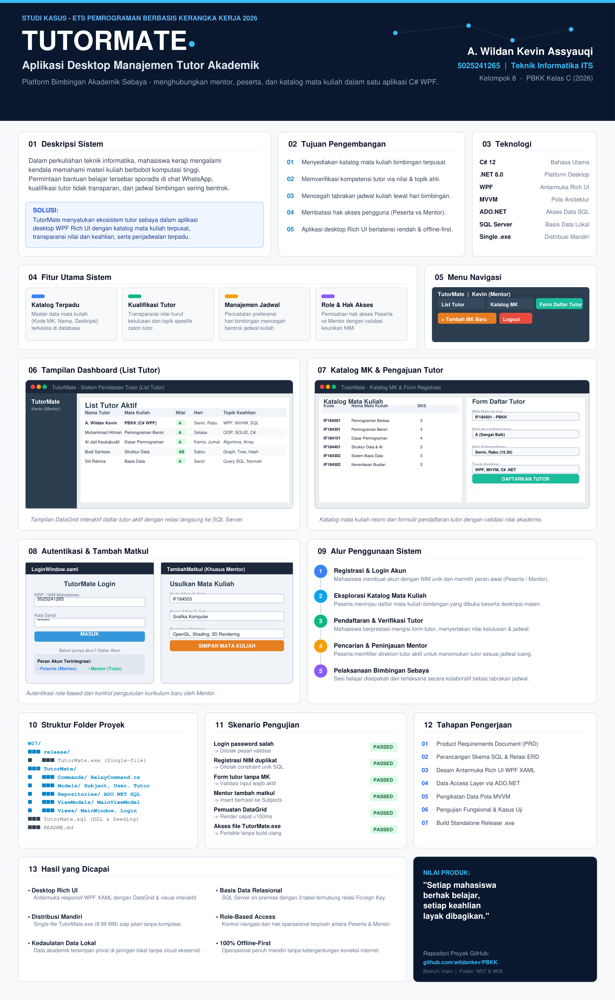

# Evaluasi Tengah Semester (ETS) / Pertemuan 8 - TutorMate: Analisis dan Infografis Aplikasi

Dokumentasi tugas evaluasi tengah semester mata kuliah **Pemrograman Berbasis Kerangka Kerja (PBKK) Kelas C - 2026**, Departemen Teknik Informatika, Fakultas Teknologi Elektro dan Informatika Cerdas, Institut Teknologi Sepuluh Nopember Surabaya.

---

## Deskripsi

Laporan ini menyajikan analisis komprehensif terkait komparasi arsitektur aplikasi desktop terhadap platform aplikasi lainnya, rumusan permasalahan akademis dan solusi fitur yang dikembangkan pada proyek **TutorMate - Aplikasi Manajemen Tutor Akademik**, serta poster infografis satu halaman yang merangkum keseluruhan nilai produk, alur kerja, dan arsitektur teknis yang telah dibangun.

---

## Tautan Dokumen & Repositori

| No | Komponen | Keterangan / Tautan |
| :-: | :--- | :--- |
| 1 | **Product Requirements Document (PRD)** | [Google Docs - PRD TutorMate Kelompok 8](https://docs.google.com/document/d/1uZbdgMPmGHO2TZzvQ9n4VjdaaDinSiKx4SfpOjJBlLM/edit?tab=t.0) |
| 2 | **Kode Sumber Aplikasi (W07)** | [GitHub - PBKK/W07](https://github.com/wildankev/PBKK/tree/main/W07) |
| 3 | **Video Dokumentasi & Demo** | [Tautan Video Demo Aplikasi (YouTube / Drive)](https://youtu.be/placeholder_video_tutormate) |

---

## Struktur Direktori

```text
W08/
├── assets/
│   └── poster_infografis.png
└── README.md
```

---

## Soal 1: Perbedaan Aplikasi Desktop dengan Aplikasi Lain & Alasan Mengapa Masih Dibutuhkan

### A. Perbandingan Karakteristik Aplikasi (Desktop vs Web vs Mobile)

Aplikasi perangkat lunak modern terbagi ke dalam tiga ekosistem utama: **Aplikasi Desktop**, **Aplikasi Web**, dan **Aplikasi Mobile**. Masing-masing platform memiliki model arsitektur, lingkungan eksekusi, serta trade-off performa yang berbeda:

| Parameter Komparasi | Aplikasi Desktop (WPF / WinForms / Native) | Aplikasi Web (SPA / SSR / Browser) | Aplikasi Mobile (Android / iOS) |
| :--- | :--- | :--- | :--- |
| **Lingkungan Eksekusi** | Berjalan langsung di atas sistem operasi lokal (native execution / managed CLR runtime). | Berjalan di dalam lingkungan terisolasi (*sandbox*) peramban web (browser engine seperti V8 / Blink). | Berjalan di atas OS mobile (Android ART / iOS Darwin) dengan batasan siklus hidup baterai dan memori. |
| **Akses Hardware & OS** | Akses penuh dan langsung (*direct access*) ke CPU multi-core, GPU hardware acceleration (DirectX), memory pointer, filesystem lokal, dan port periferal (COM, USB, scanner). | Terbatas oleh API standar web (*security sandbox*), tidak memiliki akses bebas ke sistem berkas atau hardware mesin klien. | Dibatasi oleh sistem perizinan runtime ketat (*runtime permission*), sandboxed storage, serta manajemen daya agresif. |
| **Performa & Latensi** | Performa komputasi maksimal dengan latensi ultra-rendah (*near-zero UI latency*). Mampu merender ribuan baris data (*DataGrid*) tanpa penurunan frame-rate. | Rentan terhadap latensi jaringan (*network round-trip latency*), beban parsing DOM/CSS, dan batasan eksekusi single-threaded JavaScript. | Cepat untuk task sehari-hari, namun terbatas oleh performa thermal throttling chip mobile dan kapasitas memori terbatas. |
| **Ketergantungan Jaringan** | Bersifat *Offline-First*. Mampu beroperasi penuh 100% tanpa sambungan internet menggunakan basis data lokal (*LocalDB / SQLite / on-premise SQL Server*). | Sangat bergantung pada konektivitas jaringan stabil; fungsi aplikasi terhenti jika sambungan internet/server pusat down (meskipun PWA menawarkan caching terbatas). | Dapat berjalan offline, namun umumnya bergantung pada sinkronisasi berkala dengan cloud backend via REST API. |
| **Keamanan & Kedaulatan Data** | Kedaulatan data tinggi (*Data Sovereignty*). Data sensitif dapat disimpan sepenuhnya di jaringan lokal / penyimpanan internal pengguna tanpa eksposur ke cloud publik. | Data tersimpan di server pihak ketiga atau cloud provider, menuntut kepatuhan keamanan data transfer (HTTPS, CORS, TLS). | Data tersimpan di perangkat mobile atau cloud; rentan terhadap kehilangan fisik perangkat. |
| **Ergonomi UI & Produktivitas** | Dioptimalkan untuk produktivitas kerja intensif: multi-window, multi-monitor, *keyboard shortcuts* kompleks, dialog modal, dan visualisasi berdensitas tinggi (*high data density*). | Dioptimalkan untuk konsumsi informasi cepat, scrolling vertikal, dan layout responsif lintas ukuran layar. | Dioptimalkan untuk navigasi sentuhan (*touch gestures*), layar vertikal tunggal (*one-hand usage*), dan sesi interaksi singkat. |

---

### B. Alasan Mengapa Aplikasi Desktop Masih Sangat Dibutuhkan

Meskipun aplikasi web dan mobile berkembang pesat, aplikasi desktop tetap memegang peranan krusial yang tidak dapat digantikan sepenuhnya di berbagai domain industri:

1. **Efisiensi Komputasi & Pemrosesan Data Berat (Heavy-Duty Computing):**  
   Aplikasi desktop dikompilasi secara native atau semi-native (seperti .NET JIT), memungkinkan pemanfaatan multi-threading sejati, SIMD vectorization, dan akselerasi grafis GPU (DirectX pada WPF). Ini sangat vital untuk aplikasi CAD/CAM, editing video, simulasi sains, dan sistem pengolahan tabel data berukuran jutaan baris tanpa lag.

2. **Kemandirian Operasional & Keandalan Misi Kritis (Mission-Critical Zero Dependency):**  
   Di lingkungan fasilitas medis, pabrik manufaktur, sistem kasir (Point of Sale), laboratorium, dan manajemen institusi pendidikan, ketergantungan pada koneksi internet adalah risiko operasional. Aplikasi desktop dapat terus berjalan andal selama listrik menyala tanpa terpengaruh gangguan ISP atau downtime server cloud eksternal.

3. **Keamanan, Kerahasiaan, dan Kedaulatan Data (On-Premise Data Governance):**  
   Banyak institusi perbankan, militer, dan universitas menerapkan regulasi ketat yang melarang data rahasia (seperti rekam medis atau berkas nilai) diunggah ke internet publik. Aplikasi desktop memungkinkan arsitektur basis data *on-premise* yang terisolasi dalam *Local Area Network* (LAN).

4. **Integrasi Perangkat Keras dan Periferal Khusus:**  
   Aplikasi desktop dapat dengan mudah berkomunikasi dengan perangkat eksternal melalui port serial, driver perangkat keras, scanner barcode industri, smart card reader, atau modul mikrokontroler.

5. **Pengalaman Produktivitas Kerja Intensif (Power User Experience):**  
   Pengguna profesional (seperti staf administrasi akademik, akuntan, atau analis data) membutuhkan navigasi cepat berbasis keyboard (*hotkeys*), kemampuan membuka banyak jendela kerja secara bersamaan (*multi-window workspace*), dan tata letak formulir terpadu yang padat informasi (*high-density data entry*).

---

## Soal 2: Problem yang Diselesaikan dan Definisi Fitur Solusi pada TutorMate

### A. Problem Statement (Permasalahan yang Dihadapi)

Berdasarkan analisis kebutuhan mahasiswa di lingkungan kampus dan dokumen PRD TutorMate, ditemukan beberapa permasalahan utama dalam sistem bimbingan belajar sebaya:

1. **Fragmentasi dan Ketiadaan Platform Terpusat:**  
   Selama ini proses pencarian bimbingan akademik antar mahasiswa berjalan secara informal dan sporadis lewat grup chat media sosial (WhatsApp / Telegram) atau kontak personal. Mahasiswa yang membutuhkan tutor kesulitan menemukan siapa rekan seangkatannya yang bersedia dan mampu memberikan bimbingan.

2. **Asimetri Informasi dan Ketidakpastian Kualifikasi Tutor:**  
   Calon peserta tutor sering kali merasa ragu terhadap kompetensi mahasiswa yang menawarkan bimbingan karena ketiadaan rekam jejak akademik yang valid (nilai mata kuliah, topik keahlian khusus, atau reputasi akademik).

3. **Koordinasi Waktu yang Tidak Efisien dan Tabrakan Jadwal:**  
   Proses tawar-menawar jadwal bimbingan belajar melalui pesan singkat memakan waktu lama, rawan salah paham, dan kerap berujung pada pembatalan sepihak karena jadwal kuliah yang bertabrakan.

4. **Ketiadaan Katalog Mata Kuliah yang Terstandarisasi:**  
   Tidak ada klasifikasi jelas mengenai mata kuliah apa saja yang sedang dibuka untuk bimbingan, sehingga kebutuhan belajar mahasiswa pada mata kuliah krusial (seperti PBKK, PBO, atau Struktur Data) sering tidak terfasilitasi.

---

### B. Definisi Fitur Solusi pada Aplikasi TutorMate

Untuk menyelesaikan permasalahan di atas, aplikasi **TutorMate** menyediakan solusi terintegrasi melalui fitur-fitur berikut:

```text
+------------------------------------------+        +-----------------------------------------------+
|           PERMASALAHAN NYATA             | -----> |             FITUR SOLUSI TUTORMATE            |
+------------------------------------------+        +-----------------------------------------------+
| 1. Pencarian tutor terpencar di chat WA  | -----> | FR-01: Direktori Terpusat & Katalog Terpadu   |
| 2. Ragu akan kompetensi/nilai tutor      | -----> | FR-02: Pendataan Riwayat Nilai & Topik Ahli   |
| 3. Jadwal bimbingan bentrok/tidak pasti  | -----> | FR-03: Pencatatan Hari & Waktu Bimbingan      |
| 4. Akses tidak teratur antar pengguna    | -----> | FR-04: Autentikasi Role-Based (Peserta/Mentor)|
| 5. Sulit mengusulkan mata kuliah baru    | -----> | FR-05: Modul Penambahan Katalog Mata Kuliah   |
+------------------------------------------+        +-----------------------------------------------+
```

1. **Sistem Autentikasi dan Kontrol Akses Berbasis Peran (Role-Based Authentication):**  
   - *Solusi untuk:* Membedakan hak akses dan alur kerja antara mahasiswa yang mencari bimbingan (*Peserta*) dan mahasiswa yang memberikan bimbingan (*Mentor*).
   - *Detail Fitur:* Formulir Registrasi dan Login terenkripsi dengan validasi keunikan NIM di basis data, memastikan identitas mahasiswa valid dan terproteksi.

2. **Katalog Mata Kuliah Terstruktur (Subject Catalog):**  
   - *Solusi untuk:* Menyediakan standardisasi daftar mata kuliah yang memerlukan bantuan tutor sebaya.
   - *Detail Fitur:* Menampilkan tabel mata kuliah lengkap dengan kode mata kuliah resmi (misal: `IF184501`), nama mata kuliah, dan deskripsi cakupan kompetensinya.

3. **Pendataan Kualifikasi dan Verifikasi Tutor (Tutor Qualification & Application):**  
   - *Solusi untuk:* Mengatasi asimetri informasi dan menjamin transparansi kompetensi calon tutor.
   - *Detail Fitur:* Mahasiswa yang mendaftar menjadi tutor wajib mencantumkan nilai huruf kelulusan mata kuliah (misal: Nilai `A`), topik spesifik yang dikuasai (misal: *WPF, MVVM, dan C# .NET*), dan ketersediaan jadwal bimbingan.

4. **Direktori Terbuka Tutor Terdaftar (Active Tutor Directory):**  
   - *Solusi untuk:* Memudahkan mahasiswa menemukan tutor yang sesuai dengan kebutuhan mata kuliah dan kecocokan jadwal.
   - *Detail Fitur:* Menampilkan ringkasan seluruh tutor aktif dalam tabel `DataGrid` interaktif yang menggabungkan data profil pengguna, mata kuliah bimbingan, dan hari bimbingan secara transparan.

5. **Manajemen Pengusulan Mata Kuliah Baru oleh Mentor (Course Management):**  
   - *Solusi untuk:* Memastikan katalog bimbingan selalu berkembang mengikuti kebutuhan kurikulum semester aktif.
   - *Detail Fitur:* Khusus bagi pengguna dengan peran *Mentor*, sistem menyediakan formulir penambahan mata kuliah baru yang langsung terintegrasi ke basis data SQL Server.

---

## Soal 3: Poster Infografis Aplikasi TutorMate (1 Halaman)

Poster infografis telah dirancang sebagai representasi visual satu halaman yang memuat:
1. **Identitas & Branding Produk:** Nama produk **TutorMate**, logo, dan moto *"Peer-to-Peer Academic Mentoring Platform"*.
2. **Problem & Solusi:** Latar belakang masalah mahasiswa dan ringkasan solusi sistemik yang ditawarkan.
3. **Fitur Unggulan:** Autentikasi berbasis peran, katalog mata kuliah, registrasi tutor transparan, dan dashboard bimbingan.
4. **Arsitektur Teknologi:** C#, .NET 8 WPF, ADO.NET, dan Microsoft SQL Server dengan konsep *Rich UI*.
5. **Alur Pengguna (User Flow):** Langkah registrasi, login, penjelajahan katalog, pengajuan tutor, hingga pelaksanaan bimbingan.
6. **Informasi Tim Pengembang:** Kelompok 8 - Teknik Informatika ITS 2026.

---

### Tangkapan Layar Poster Infografis

Berikut adalah visualisasi poster infografis satu halaman untuk aplikasi TutorMate:



Terimakasih.

---

## Identitas Kelompok
- **Mata Kuliah** : Pemrograman Berbasis Kerangka Kerja (C)
- **Tugas**       : Evaluasi Tengah Semester (ETS) / Pertemuan 8
- **Kelompok**    : 8 (Delapan)
- **Anggota Kelompok**:
  1. Muhammad Hilman Azhar (NRP: 5025241264)
  2. A. Wildan Kevin Assyauqi (NRP: 5025241265)
  3. Al Jad Kaukabudduri Hardianto (NRP: 5025241248)
- **Departemen**  : Teknik Informatika, Fakultas Teknologi Elektro dan Informatika Cerdas, Institut Teknologi Sepuluh Nopember
